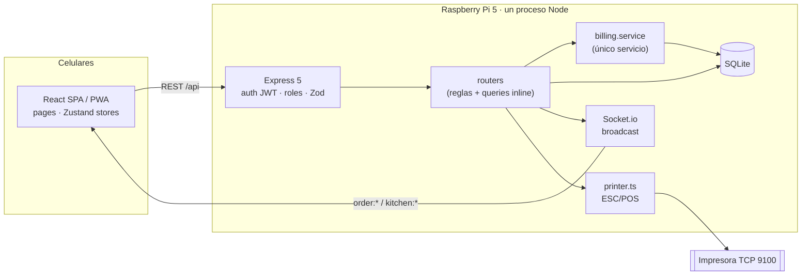

# Documentación de arquitectura — MauiDesk

Punto de entrada de la documentación técnica de **MauiDesk**, el POS de la Cevichería MAUI (Tacna, Perú). Este documento resume todo lo necesario para entender el sistema; los enlaces llevan al detalle.

| | |
|---|---|
| **Código analizado** | Rama `main` @ `85664bb` ("feat(h3): robustez operacional…") |
| **Fecha del análisis** | 2026-09-23 |
| **Método** | Lectura completa del código (server, client, configuración, scripts, despliegue) + ejecución de tests, typecheck y lint + 6 verificaciones empíricas sobre SQLite temporales ([testing.md](testing.md#5-verificaciones-ejecutadas-durante-el-análisis)) |
| **Cambios al código** | Ninguno. Esta carpeta es el único agregado |

---

## Resumen ejecutivo

MauiDesk es un **monolito cliente-servidor self-hosted**: una SPA React (PWA para celulares) y un servidor Node/Express 5 con Socket.io, que persiste en un archivo **SQLite** y se despliega en una **Raspberry Pi 5** dentro de la LAN del local, sin nube. Cubre la operación de salón y delivery: pedidos por mesa, comanda impresa (la cocina no tiene pantalla), cobro en efectivo/Yape/Plin con cobros parciales y cuentas divididas, boleta térmica interna, historial, reportes y administración de menú y usuarios.

El cobro está bien encaminado: el número de boleta se genera en el servidor, todo ocurre en una transacción y hay una capa de servicio con tests. Sin embargo, **el servidor no es la autoridad sobre las reglas centrales de la venta**:

- El precio de cada ítem lo envía el cliente (TD-01).
- Cualquier rol puede cancelar o cerrar pedidos sin rastro (TD-02).
- Es posible cobrar dos veces el mismo ítem (TD-03, verificado).

No existen los módulos de **caja** (apertura/cierre/arqueo), **anulación de boletas**, **inventario**, **clientes** ni **configuración**; las "boletas" no son comprobantes electrónicos.

---

## Stack tecnológico

Versiones resueltas en `server/package-lock.json` y `client/package-lock.json`.

| Componente | Tecnología | Versión | Uso |
|---|---|---|---|
| Runtime | Node.js | 20 LTS según `DEPLOYMENT.md` (fuera de soporte, TD-34); sin `engines` | Servidor y tooling |
| Lenguaje | TypeScript | 6.0.3 | Server (strict, CommonJS, ES2020) y client (bundler, ES2023) |
| HTTP | Express | 5.2.1 | API REST y archivos estáticos del cliente |
| Tiempo real | Socket.io / socket.io-client | 4.8.3 | Eventos de pedidos y resultados de impresión |
| ORM | Drizzle ORM | 0.45.2 | Query builder desde los routers |
| Esquema | drizzle-kit | 0.31.10 | `db:push` (sin migraciones versionadas) |
| Driver | @libsql/client | 0.17.3 | SQLite en archivo local (FK activas) |
| Base de datos | SQLite (embebido en libsql) | No determinado | Persistencia única |
| Validación | Zod | 4.4.3 | Schemas de body y query |
| Autenticación | jsonwebtoken · bcryptjs | 9.0.3 · 3.0.3 | JWT de 12 h · hash de contraseñas (costo 10) |
| CORS / config | cors · dotenv | 2.8.6 · 17.4.2 | Allowlist · variables de entorno |
| Imágenes (build) | jimp | 0.22.12 | Logo ESC/POS e íconos PWA (scripts manuales) |
| Tests | Vitest | 4.1.8 | 11 tests del servicio de cobro |
| Dev runner / lint | tsx · ESLint | 4.21.0 · 10.x | `npm run dev` · `npm run ci` |
| UI | React · react-dom | 19.2.5 | SPA |
| Build | Vite (+ @vitejs/plugin-react 6) | 8.0.10 | Dev server con proxy y build a `client/dist` |
| Estilos | Tailwind CSS | 4.2.4 | Utilidades en JSX |
| Estado | Zustand | 5.0.12 | Stores de sesión, borrador, pedidos, toasts y conexión |
| Rutas | React Router | 7.14.2 | Rutas con guardas por rol |
| HTTP cliente | axios | 1.15.2 | Interceptores de token y 401 |
| Gráficos · íconos | Recharts · lucide-react | 3.8.1 · 1.14.0 | Reportes · UI |
| Drag & drop | @dnd-kit/* | 6.3.1 | **Declarado, sin uso** |
| Impresión | ESC/POS propio (`utils/printer.ts`) | — | TCP 9100 (producción) / cola de Windows (desarrollo) |
| Infraestructura | Raspberry Pi OS Lite 64-bit, systemd, cron + `sqlite3 .backup`, Tailscale | — | `DEPLOYMENT.md` |

**Declarado vs. real:** `@dnd-kit/*` sigue en `package.json` sin uso; `CLAUDE.md` describe un store `receipt` y un error `409 RECEIPT_TAKEN` que ya no existen; el commit `85664bb` habla de "CI", pero solo hay un script `npm run ci` sin pipeline; `CLAUDE.md` menciona un SSD, mientras que `DEPLOYMENT.md` documenta una microSD (TD-28).

---

## Arquitectura en una vista

- **Capas reales:** páginas React (incluyen cálculos y armado de lo impreso) → stores → axios/socket → middleware → routers con lógica y queries inline → SQLite. Solo el cobro tiene capa de servicio.
- **Tiempo real:** broadcast del pedido completo a todos los sockets; sin resincronización.
- **Transacciones:** solo en el cobro y en la creación de sub-cuentas.

Detalle en [architecture.md](architecture.md); mapa completo del sistema en [architecture.md §11](architecture.md#11-mapa-general-del-sistema).

---

## Módulos

| Módulo funcional | Estado | Módulo funcional | Estado |
|---|---|---|---|
| Ventas (pedidos + cobro) | Parcial | Reportes | Parcial |
| Productos (menú) | Parcial | Mesas y plano | Completo |
| Usuarios | Completo (brechas de seguridad) | Impresión | Completo (brechas) |
| Inventario | **No existe** | Clientes | **No existe** |
| Caja (sesiones, arqueo) | **No existe** | Configuración | **No existe** |

Módulos técnicos: 16 en el servidor (bootstrap, auth, validación, menú, pedidos, división, cobro, reportes, impresión, mesas, usuarios, persistencia, utilidades, tiempo real, tests, scripts) y 17 en el cliente. Inventario completo, dependencias y elementos sin uso en [modules.md](modules.md).

---

## Hallazgos principales

**34 problemas** registrados (2 críticos, 4 altos, 14 medios, 14 bajos) y **9 brechas funcionales**. Registro completo en [technical-debt.md](technical-debt.md).

### Críticos
- **TD-01. Precios definidos por el cliente.** `POST /api/orders` y `/orders/:id/items` guardan el `unitPrice` y el `dishName` que envía el navegador. Cualquier usuario puede fijar precios, y los borradores persistidos arrastran precios viejos.
- **TD-02. Cancelar o cerrar pedidos sin control.** `DELETE /api/orders/:id` y `PATCH …/status=paid` funcionan para cualquier rol, sin validar si hay boletas y sin registrar quién lo hizo. Una venta puede desaparecer de los reportes.

### Altos
- **TD-03. Doble cobro (verificado):** dos boletas por S/ 112 para un consumo de S/ 56 cuando dos cobros del mismo pedido se solapan.
- **TD-04. Pedidos e ítems duplicados** por doble toque o por dos mozos simultáneos (sin guardia en la UI ni atomicidad en el servidor).
- **TD-05. XSS en el reporte HTML:** un mozo puede robar la sesión del dueño.
- **TD-06. Mesa equivocada en comandas y boletas:** se imprime `tables.id` en lugar de `tables.number`.

### Otros hallazgos verificados
- "Top platos" sobrecuenta en cuentas divididas (TD-09), la serie diaria usa el día UTC (TD-10), los cobros concurrentes fallan con `SQLITE_BUSY` → 500 (TD-11) y `drizzle-kit push` borra los índices creados al arrancar (TD-18).
- Las **claves foráneas sí se aplican** (aclara una duda del análisis anterior).

### Lo que está bien resuelto
- Número de boleta generado en el servidor, dentro de la transacción, con `UNIQUE` y reintento.
- El cobro completo (boleta, ítems, sub-cuenta, pedido, mesa) es atómico; los eventos se emiten después del commit.
- Validación Zod en todas las entradas con body; queries parametrizadas (no se encontró inyección SQL).
- Snapshot de nombre y precio en `order_items`: cambiar el menú no altera el historial.
- `JWT_SECRET` validado al arrancar; sockets autenticados; salvaguarda del último dueño activo; borrado lógico donde hay historial.
- `tsc` limpio en server y client; 11/11 tests pasan; ESLint sin errores.

### Recomendación inmediata (P0)
[REC-03](recommendations.md#rec-03--cobro-atómico-e-idempotente) (cobro que revalida dentro de la transacción e idempotente) → [REC-01](recommendations.md#rec-01--precios-autoritativos-en-el-servidor) (precios desde la BD) → [REC-02](recommendations.md#rec-02--máquina-de-estados-del-pedido-y-control-de-cancelaciones) (máquina de estados y control de cancelaciones), cada una con sus tests. Plan completo en [recommendations.md](recommendations.md).

---

## Índice de documentos

| Documento | Contenido |
|---|---|
| [system-overview.md](system-overview.md) | Propósito, usuarios y roles, funcionalidades, componentes, dependencias externas, flujo general |
| [architecture.md](architecture.md) | Estilo, despliegue, capas, flujo de una petición, tiempo real, persistencia, errores, patrones, decisiones, mapa general |
| [modules.md](modules.md) | Módulos funcionales del POS (existentes, parciales, inexistentes), inventario de módulos técnicos, dependencias, elementos sin uso |
| [data-model.md](data-model.md) | Motor, diagrama ER, tablas, restricciones, índices, borrado lógico, cadena de venta, invariantes, migraciones |
| [api.md](api.md) | Convenciones, 54 endpoints, eventos Socket.io, endpoints sin uso, inconsistencias |
| [business-flows.md](business-flows.md) | Venta, pago, división, cancelación, impresión, gastos, flujos inexistentes, consistencia y transacciones |
| [security.md](security.md) | Autenticación, autorización (matriz), validación, XSS, CORS/CSRF, exposición de datos, secretos, riesgos |
| [testing.md](testing.md) | Herramientas, tests existentes, resultados, cobertura, escenarios críticos, verificaciones del análisis |
| [technical-debt.md](technical-debt.md) | Registro TD-01…TD-34 y GAP-01…GAP-09 con severidad y evidencia |
| [recommendations.md](recommendations.md) | Arquitectura actual vs. recomendada, REC-01…REC-21 priorizadas, secuencia sugerida |
| [../plan-maui-v1.1.md](../plan-maui-v1.1.md) | **Plan de ejecución** para cerrar MAUI v1.1 antes de crear el producto: clasificación de cada TD, tareas, decisiones, despliegue y criterio de "listo" |

### Correspondencia con el informe solicitado

| Sección | Dónde |
|---|---|
| A. Resumen ejecutivo · B. Stack | Este documento |
| C. Arquitectura | [architecture.md](architecture.md) |
| D. Módulos funcionales · E. Módulos técnicos | [modules.md](modules.md) §1 y §2–3 |
| F. Flujo de ventas | [business-flows.md](business-flows.md) §1 y §3 |
| G. Modelo de datos | [data-model.md](data-model.md) |
| H. API | [api.md](api.md) |
| I. Seguridad | [security.md](security.md) |
| J. Consistencia y transacciones | [business-flows.md §11](business-flows.md#11-consistencia-y-transacciones-de-las-operaciones-críticas) y [data-model.md §7](data-model.md#7-el-modelo-garantiza-consistencia) |
| K. Testing | [testing.md](testing.md) |
| L. Problemas detectados · M. Deuda técnica | [technical-debt.md](technical-debt.md) |
| N. Recomendaciones | [recommendations.md](recommendations.md) |
| O. Mapa general del sistema | [architecture.md §11](architecture.md#11-mapa-general-del-sistema) |

---

## Relación con otra documentación

- **`CLAUDE.md`** (raíz): guía operativa para desarrollo. Sigue siendo válida en general, con las desviaciones anotadas en TD-28.
- **`DEPLOYMENT.md`** (raíz): guía de despliegue en la Pi. No documenta la restauración de backups, la segmentación de red ni la zona horaria explícita del servicio (REC-20).
- **Análisis previo:** la rama remota `docs/analisis-y-roadmap` (commit `d9c40e4`) contiene `docs/PROJECT_ANALYSIS.md`, `ARCHITECTURE_MAP.md`, `BUSINESS_RULES.md`, `DATABASE_ANALYSIS.md` y `ROADMAP.md`, escritos sobre `24edfa9` (antes de H1–H3) y **no fusionados a `main`**. No se modificaron. Esta documentación los reemplaza como referencia del estado actual; el estado de cada uno de sus hallazgos está en [technical-debt.md](technical-debt.md#estado-de-los-hallazgos-del-análisis-anterior).

## Alcance y límites del análisis

- **No se ejecutó la aplicación completa** (servidor + cliente + impresora), no se probaron los flujos en la UI y no hubo acceso a la BD ni a la Pi de producción. Los comportamientos marcados como "verificado" se reprodujeron llamando directamente al código del repo.
- **No determinado con la evidencia disponible:** modo de journal de SQLite en producción; si la WiFi del POS es compartida con clientes; obligaciones tributarias (SUNAT) del negocio; si el negocio necesita inventario; datos reales de producción (p. ej., si ya existen mesas con `id ≠ number` o pedidos activos duplicados).
- No se auditaron las dependencias de terceros en busca de vulnerabilidades conocidas (`npm audit` no se ejecutó).
