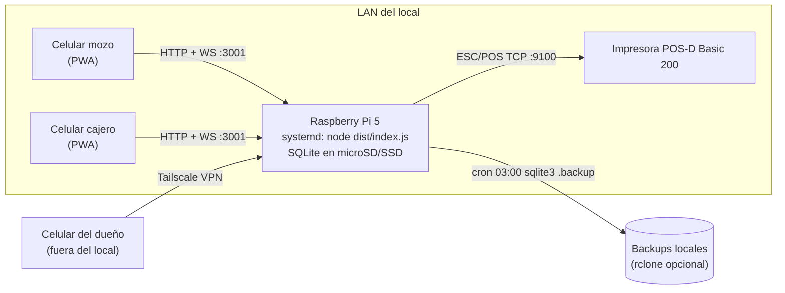
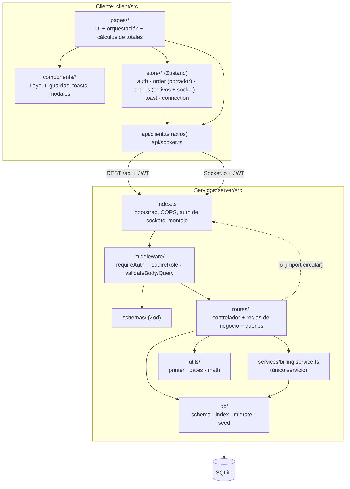
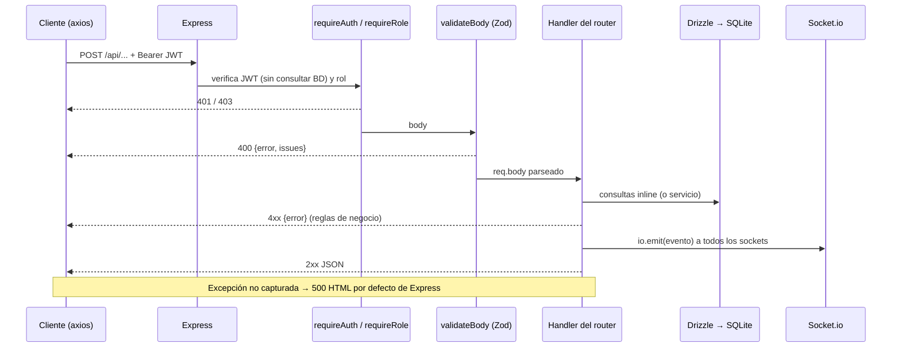
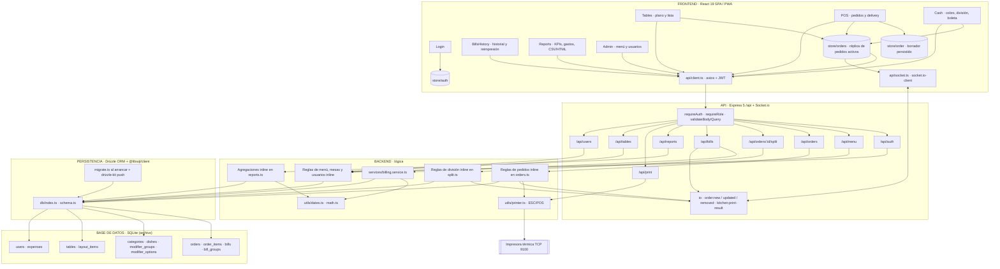

# Arquitectura

> Parte de la [documentación de arquitectura](README.md). Snapshot `main` @ `85664bb` (2026-09-23).
> Describe la arquitectura **real** reconstruida del código. La arquitectura propuesta está en [recommendations.md](recommendations.md#1-arquitectura-actual-vs-recomendada).

## 1. Estilo arquitectónico

**Monolito cliente-servidor, self-hosted, de un solo proceso**, organizado como dos paquetes npm independientes (`server/`, `client/`) y un `package.json` raíz que solo orquesta scripts.

- **Servidor:** una aplicación Express 5 con Socket.io en el mismo proceso y puerto (3001). Accede a un archivo SQLite local. En producción también sirve el bundle estático del cliente (`server/src/index.ts:105-113`), así que hay **un solo origen**.
- **Cliente:** SPA React 19 compilada con Vite, instalable como PWA, pensada para celulares.
- **No es un monolito modular:** no hay límites de módulo explícitos ni interfaces entre dominios. Los routers se agrupan por recurso HTTP y acceden directamente a cualquier tabla.
- **No hay servicios externos en tiempo de ejecución** salvo la impresora térmica (TCP). No hay nube, colas ni caché.

## 2. Despliegue

Evidencia: `DEPLOYMENT.md` (Fases 1–11), `server/.env.example`. Una sola impresora recibe las comandas y las boletas (`server/src/utils/printer.ts:299-314`); la cocina no tiene pantalla.

## 3. Capas

| Capa | Responsabilidad real | Observación |
|---|---|---|
| `pages/` (cliente) | Presentación, flujos de usuario, **cálculo de totales mostrados**, armado del contenido de la boleta y la pre-cuenta impresas, **fijación del precio de venta** | Parte de la lógica de negocio vive aquí (TD-01, TD-14) |
| `store/` (cliente) | Estado global; `orders` es la réplica local de los pedidos activos, mantenida por eventos de socket | Deriva el estado de las mesas (TD-08) |
| `api/` (cliente) | Transporte HTTP/WS con el token | Maneja el 401 globalmente |
| `middleware/` | Autenticación, autorización por rol, validación de forma | Sin manejador de errores (TD-21) |
| `schemas/` | Contratos de entrada (Zod) | No hay contratos de salida ni tipos compartidos con el cliente |
| `routes/` | **Controlador + dominio + acceso a datos** en el mismo handler | Excepción: el cobro delega en el servicio |
| `services/` | Cobro: resolución de ítems, total, transacción, numeración | Recibe `db` por parámetro (testeable) |
| `utils/` | ESC/POS y transporte a la impresora; fechas; dinero | `printer.ts` mezcla plantillas y transporte |
| `db/` | Esquema Drizzle, cliente libsql, migraciones al arrancar, seed | Dos fuentes de verdad del esquema (TD-18) |

## 4. Flujo de una petición

## 5. Tiempo real

- **Canal:** un solo namespace de Socket.io. Autenticación con JWT en el handshake (`index.ts:74-86`); `socket.data.user` guarda el payload, pero no se usa para segmentar.
- **Patrón:** *broadcast* de estado completo. El servidor emite el pedido serializado entero en `order:new` / `order:updated`, o el id en `order:removed`. El cliente reemplaza su copia (`store/orders.ts:125-143`).
- **Consistencia:** eventual y sin recuperación. Si se pierde un evento (desconexión), la réplica local queda desactualizada hasta recargar (TD-12). No hay versión ni secuencia.
- **Detalle en** [api.md](api.md#3-eventos-socketio).

## 6. Persistencia y transacciones

- Drizzle se usa como query builder directamente desde los handlers; **no hay repositorios**.
- Transacciones explícitas solo en: cobro (`billing.service.ts:98-150`) y creación de sub-cuentas (`split.ts:80-108`). El resto de las operaciones de varios pasos son sentencias independientes (TD-04, TD-23).
- Las transacciones concurrentes no se encolan: la segunda falla con `SQLITE_BUSY`, porque no hay `busy_timeout` ni reintento (TD-11, verificado en V2).
- Detalle en [data-model.md](data-model.md).

## 7. Manejo de errores

| Capa | Estrategia |
|---|---|
| Validación | 400 con `issues` detallados |
| Negocio (cobro) | `BillingError(statusCode)` → el router traduce a HTTP (`bills.ts:115-123`) |
| Negocio (resto) | `res.status(4xx).json({error})` inline |
| Impresión | `try/catch` → 500 `{ok:false, error}`; la comanda automática informa por socket |
| No controlados | Sin manejador global: Express 5 captura el rechazo async y responde 500 HTML (TD-21) |
| Cliente | Toasts (`useToastStore`) en casi todos los flujos; excepciones: `Reports.tsx` (sin catch) y `POS.tsx:331` (`confirm()`) |

## 8. Configuración

Toda la configuración está en variables de entorno (`server/.env`), cargadas con `dotenv` en `index.ts`, `db/index.ts`, `db/migrate.ts` y `drizzle.config.ts`: `PORT`, `NODE_ENV`, `JWT_SECRET`, `ALLOWED_ORIGINS`, `DATABASE_URL`, `PRINTER_TYPE`, `PRINTER_HOST`, `PRINTER_PORT`, `PRINTER_NAME`. Solo `JWT_SECRET` y `ALLOWED_ORIGINS` se validan al arrancar. Los datos del negocio y la serie de boletas están en el código (GAP-07).

## 9. Patrones detectados

| Patrón | Dónde | Comentario |
|---|---|---|
| Cadena de middleware | `requireAuth → requireRole → validateBody → handler` | Consistente en todos los routers |
| Validación por esquema (Zod) | `schemas/*` + `validate.ts` | Bien aplicado a la forma de los datos |
| Servicio con inyección de dependencias | `createBill(db, params)` | Solo en el cobro; es el que permite los tests |
| Error de dominio tipado | `BillingError` | Solo en el cobro |
| Snapshot de precio/nombre en la línea | `order_items.dish_name/unit_price` | Correcto para el historial; el problema es el origen del dato (TD-01) |
| Borrado lógico | `users.active`, `tables.active`, `dishes.available`, `orders.status=cancelled` | Mezclado con borrado físico según el caso |
| Publicación de estado (pub/sub broadcast) | `io.emit` + stores Zustand | Sin resincronización |
| Store global (Flux ligero) | Zustand | Un store por preocupación |
| UI optimista | `markOrderPaying` (`store/orders.ts:192-197`) | Se revierte con el siguiente evento (TD-08) |
| Migraciones idempotentes al arrancar | `migrate.ts` | Convive con `drizzle-kit push` (TD-18) |
| Verificación previa de salud antes de un efecto | `checkPrinterStatus()` antes de enviar a la impresora | Falla rápido, sin cola |

**No se encontraron:** repositorios, CQRS, event sourcing, colas, caché, inyección de dependencias general ni arquitectura hexagonal/limpia.

## 10. Decisiones arquitectónicas relevantes

Reconstruidas del código, los comentarios, `CLAUDE.md`, `DEPLOYMENT.md` y el historial de git.

| Decisión | Motivo aparente | Consecuencia |
|---|---|---|
| Todo local en una Raspberry Pi, sin nube | Operar sin internet, bajo costo | Un único punto de falla; backups por cron |
| SQLite en archivo | Simplicidad, sin servidor de BD | Un solo escritor a la vez; exige manejar `SQLITE_BUSY` |
| Cliente servido por el mismo proceso | Un origen, un puerto | Sin problemas de CORS en producción |
| Cocina sin pantalla, solo comanda impresa | Operación real del local (`CLAUDE.md`, `App.tsx:42-43`) | La impresora es crítica; hace falta poder reimprimir (TD-17) |
| Impresión por TCP directo, sin cola | Evitar trabajos atascados (`printer.ts:299-305`) | Si falla, el usuario debe reintentar |
| Numeración de boletas en el servidor (H1, `e89587d`) | Evitar colisiones entre dispositivos | Resuelto |
| Extraer el cobro a un servicio con tests (H2, `5200066`) | Red de seguridad | Único módulo testeado |
| JWT en `localStorage`, 12 h, sin refresh | Sesión persistente en celulares | Sin revocación (TD-13); expuesto a XSS (TD-05) |
| Broadcast de eventos a todos | Pocos dispositivos | Todos los roles reciben todo |
| Pedido y boleta separados (N boletas por pedido) | Cobros parciales y cuentas divididas | Los reportes deben agregar por `bill_id` (TD-09) |

## 11. Mapa general del sistema

Lectura del mapa: la única pieza de "backend" separada del transporte HTTP es el servicio de cobro. Las demás reglas viven dentro de los routers. Ningún módulo toca inventario ni caja porque no existen.
