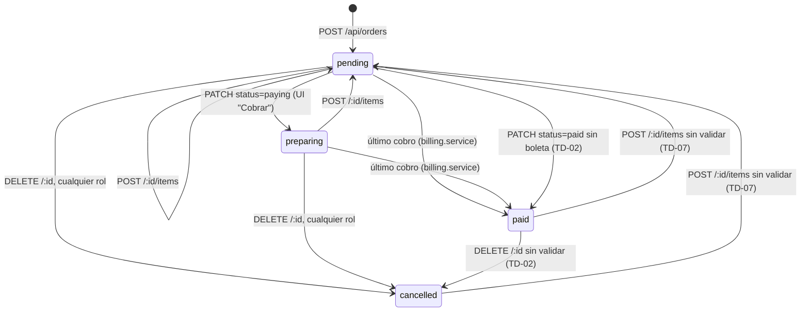
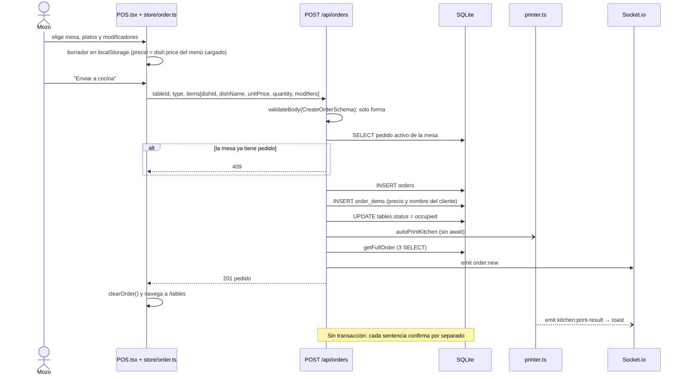
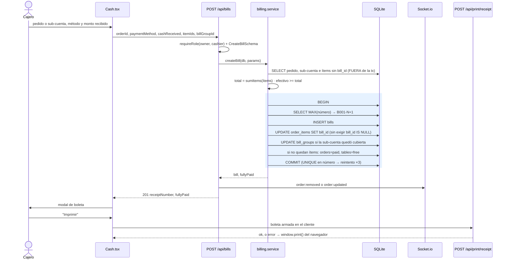
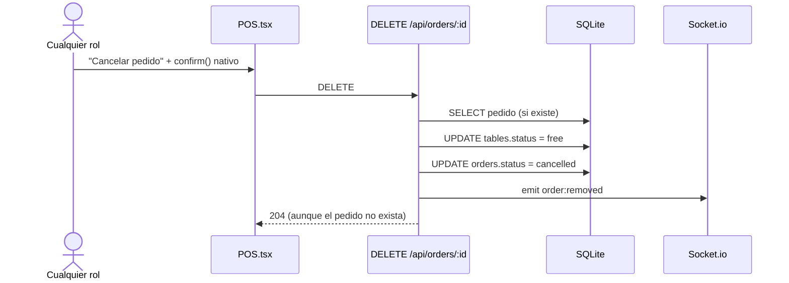

# Flujos de negocio

> Parte de la [documentación de arquitectura](README.md). Snapshot `main` @ `85664bb` (2026-09-23).
> Cada flujo está reconstruido desde el código. Los que **no existen** se indican explícitamente, junto con lo más parecido que ofrece el sistema.

| Flujo | Estado |
|---|---|
| [Venta: toma de pedido](#1-venta-toma-de-pedido) | Implementado (sin transacción, precios del cliente) |
| [Agregar ítems a un pedido](#2-agregar-ítems-a-un-pedido) | Implementado |
| [Pago / cobro](#3-pago--cobro) | Implementado (transaccional, con defecto TD-03) |
| [Cuenta dividida](#4-cuenta-dividida) | Implementado |
| [Cancelación](#5-cancelación) | Implementado sin controles |
| [Pre-cuenta y reimpresión](#6-pre-cuenta-reimpresión-y-comanda) | Implementado |
| [Gastos](#7-gastos) | Implementado |
| [Apertura y cierre de caja](#8-apertura-y-cierre-de-caja) | **No existe** |
| [Devolución / anulación](#9-devolución-y-anulación) | **No existe** |
| [Actualización y ajuste de inventario](#10-actualización-y-ajuste-de-inventario) | **No existe** |
| [Consistencia y transacciones (resumen)](#11-consistencia-y-transacciones-de-las-operaciones-críticas) | — |

---

## Ciclo de vida del pedido (tal como está implementado)

- `ready` solo se alcanza con `PATCH /toggle` o `/ready`, que ya no usa ninguna pantalla.
- "Por cobrar" (`paying`) se persiste como `preparing`, así que la UI no puede distinguirlo después del siguiente evento (TD-08).
- Las transiciones marcadas con TD son posibles hoy pero no deberían serlo ([REC-02](recommendations.md#rec-02--máquina-de-estados-del-pedido-y-control-de-cancelaciones)).

---

## 1. Venta: toma de pedido

### Pasos genéricos de una venta vs. lo que existe

| Paso | ¿Existe? | Dónde ocurre |
|---|---|---|
| Seleccionar producto | ✅ | `client/src/pages/POS.tsx:400-410`, modal de modificadores `92-182` |
| Agregar al carrito | ✅ | `client/src/store/order.ts:42-44` (persistido en `localStorage`) |
| Calcular subtotal | ✅ solo en el cliente e informativo | `POS.tsx:274`; el total real se calcula al cobrar |
| Descuentos / impuestos | ❌ | GAP-03, GAP-04 |
| Enviar solicitud | ✅ | `POS.tsx:283-307` → `store/orders.ts:165-168` |
| Validación en backend | ⚠️ parcial: forma y mesa ocupada; **no** precio ni disponibilidad | `server/src/routes/orders.ts:114-124` |
| Validar stock | ❌ no existe inventario | — |
| Crear la venta | ⚠️ se crea un *pedido*; la venta contable (`bills`) nace al cobrar | `orders.ts:126-135` |
| Registrar detalles | ✅ | `orders.ts:138-152` |
| Descontar inventario | ❌ | — |
| Comanda a cocina | ✅ asíncrona, no bloquea | `orders.ts:20-82`, `160-165` |
| Registrar pago | ✅ en el cobro | `server/src/services/billing.service.ts:106-115` |
| Movimiento de caja | ❌ | GAP-01 |
| Generar comprobante | ✅ número en el servidor; la impresión la dispara el cliente | `billing.service.ts:99-104`; `client/src/pages/Cash.tsx:69-96` |
| Responder al frontend | ✅ + eventos de socket | `orders.ts:167-169`; `bills.ts:127-140` |

### Dónde se calcula cada cosa

| Cálculo | Lugar | Autoridad |
|---|---|---|
| Precio unitario | Cliente (`dish.price` del menú cargado) | ❌ el servidor lo acepta tal cual (TD-01) |
| Subtotal del borrador / pedido | Cliente (`POS.tsx:274`, `store/orders.ts:223-233`, `Cash.tsx:611`) | Informativo |
| Total de la boleta | Servidor, `sumItems` + `roundMoney` (`billing.service.ts:80`, `utils/math.ts:10-12`) | ✅ (sobre precios del cliente) |
| Vuelto | Servidor (`billing.service.ts:112`); la UI lo recalcula para mostrarlo | ✅ |
| Número de boleta | Servidor, `MAX+1` en la transacción | ✅ |

### ¿Qué pasa si falla a mitad?

| Punto de falla | Resultado |
|---|---|
| `INSERT orders` | Nada persiste; 500 |
| `INSERT order_items` (p. ej., `dishId` inexistente → FK) | **Queda un pedido activo sin ítems** y la mesa figura `free` en la BD; no se emite evento. El siguiente intento para esa mesa recibe 409 ("ya tiene un pedido activo") hasta que alguien lo cancele |
| `UPDATE tables` | Pedido e ítems persisten; `tables.status` desactualizado (la UI no lo usa) |
| Impresión | El pedido persiste; toast "No se imprimió la comanda" **sin botón para reintentar** (TD-17) |
| `getFullOrder` / emit tras escribir | El pedido existe pero la respuesta es 500: el mozo reintenta → 409 (mesa) o **pedido duplicado** (delivery) |
| Doble toque en "Enviar" | Dos requests en paralelo → posible doble pedido o doble comanda (TD-04) |

---

## 2. Agregar ítems a un pedido

`POST /api/orders/:id/items` (`orders.ts:173-227`) desde el POS en "modo pedido existente" (`POS.tsx:309-327`).

1. Inserta los ítems (precio del cliente) **sin verificar que el pedido exista ni su estado**.
2. Si el pedido tiene cuenta dividida: con 1 sub-cuenta abierta, asigna los ítems a ella; con 0 abiertas y alguna pagada, crea "Cuenta X" automáticamente; con 2 o más abiertas, los deja sin asignar para que el cajero decida.
3. Fuerza `status='pending'` (reabre pedidos pagados o cancelados, TD-07).
4. Imprime **solo** los ítems nuevos ("++ ITEMS AGREGADOS ++") y emite `order:updated`.

No es transaccional; tiene el mismo riesgo de doble envío que la creación (TD-04).

---

## 3. Pago / cobro

**Modos de cobro** (`billing.service.ts:35-76`): (1) sub-cuenta + ítems confirmados, (2) sub-cuenta completa, (3) ítems específicos, (4) todo lo pendiente. En la UI, si hay sub-cuentas abiertas, el cobro total queda bloqueado hasta elegir una (`Cash.tsx:638-640`).

**Registro del pago:** el pago no es una entidad: son las columnas `payment_method`, `cash_received` y `change_amount` de la boleta. Un método por boleta; Yape/Plin se confirman manualmente con un checkbox (`Cash.tsx:819-828`), sin integración.

**Garantías:** boleta, marcado de ítems, cierre de sub-cuenta, cierre del pedido y liberación de la mesa ocurren **en una sola transacción** (todo o nada). Los eventos se emiten después del commit. La UI evita el doble clic (`Cash.tsx:621-629`).

**Fallas:**

| Situación | Resultado |
|---|---|
| Efectivo insuficiente, pedido o sub-cuenta inexistente, sub-cuenta ya cobrada, nada pendiente | `BillingError` → 400/404/409 y toast |
| Dos cobros solapados del mismo pedido | El 2.º falla con `SQLITE_BUSY` → 500 (TD-11, verificado V2) |
| 2.º cobro cuya transacción empieza tras el commit del 1.º | **Doble boleta por los mismos ítems** (TD-03, verificado V5) |
| Falla después del commit (emit/respuesta) | La boleta existe pero el cajero ve un error; al reintentar recibe "No hay items pendientes" y puede reimprimir desde Historial |
| Falla la impresora | La boleta ya está registrada; se usa `window.print()` como alternativa |

**Movimiento de caja:** no existe (GAP-01). El efectivo solo queda registrado como `bills.total` con `payment_method='cash'`.

---

## 4. Cuenta dividida

1. El cajero abre "Dividir" (`Cash.tsx:190-581`) y asigna ítems a columnas A–F.
2. Al cobrar una columna con cambios sin guardar, primero `POST /api/orders/:id/split` (`split.ts:41-118`): valida los ítems **fuera** de la transacción y, **dentro** de ella, borra las sub-cuentas abiertas, limpia `bill_group_id` de los ítems no bloqueados y crea las nuevas. Las sub-cuentas pagadas se preservan.
3. Luego se cobra con `billGroupId` (flujo 3). Cuando la sub-cuenta queda cubierta, pasa a `paid` dentro de la transacción del cobro.
4. "Deshacer" (`DELETE`, `split.ts:122-148`) elimina solo las sub-cuentas abiertas, **sin transacción** (TD-23).

La UI identifica el `billGroupId` recién creado por la posición en el arreglo devuelto (`Cash.tsx:362-367`); depende de que el servidor conserve el orden de inserción.

---

## 5. Cancelación

- No hay control de rol, motivo, auditoría ni verificación de estado. Un pedido **con boletas** (parcialmente cobrado) o **ya pagado** se puede cancelar: las boletas quedan, los ítems no cobrados desaparecen de la operación y no se registra quién lo hizo (TD-02, TD-16).
- No hay anulación de ítems individuales ya enviados a cocina: solo se quitan del borrador antes de enviar.
- Las sentencias no forman una transacción.

---

## 6. Pre-cuenta, reimpresión y comanda

| Operación | Endpoint | Origen de los datos | Evidencia |
|---|---|---|---|
| Comanda automática | (interno) | BD (ítems recién insertados) | `orders.ts:20-82` |
| Reimpresión de comanda | `POST /api/orders/:id/reprint-kitchen` | BD | `orders.ts:230-279` — **sin UI** (TD-17) |
| Pre-cuenta | `POST /api/print/pre-receipt` | **Cliente** | `Cash.tsx:987-1020` |
| Boleta tras cobrar | `POST /api/print/receipt` | **Cliente** | `Cash.tsx:69-96` (TD-14) |
| Reimpresión de boleta | `POST /api/print/reprint/:billId` | BD | `print.ts:90-147`, `BillsHistory.tsx:122-133` |

Todos pasan por `sendToPrinter` (`printer.ts:299-314`), que verifica la conectividad **antes** de enviar y falla de inmediato si la impresora no responde (no hay cola). La mesa impresa es `tableId`, no el número (TD-06).

---

## 7. Gastos

`POST /api/reports/expenses` desde Reportes (solo `owner` en la UI; el servidor también acepta `cashier`). Fecha local por defecto (`localDateString`). La edición y el borrado existen solo en la API (GAP-08) y el borrado es físico. Los reportes calculan "Balance neto = ventas − gastos" (`Reports.tsx:172-173`). Los gastos no están vinculados a ninguna caja.

---

## 8. Apertura y cierre de caja

**No existe** (GAP-01). No hay monto inicial, cierre, arqueo, conteo, diferencias ni movimientos de ingreso o egreso. Lo más parecido:

- **Historial** (`BillsHistory.tsx`): total del día y por método (efectivo/Yape/Plin) de las boletas filtradas.
- **Reportes** (`reports.ts:16-56`): ventas por período y por método.

Estos datos permiten un cuadre manual del efectivo, pero sin registro del monto contado ni de diferencias. Propuesta: [REC-08](recommendations.md#rec-08--módulo-de-caja-sesiones-arqueo-y-diferencias).

---

## 9. Devolución y anulación

**No existen** (GAP-02). No hay endpoint que anule o modifique una boleta ni que libere sus ítems. Un cobro erróneo solo se corrige editando la BD a mano. La cancelación de pedidos (flujo 5) no revierte boletas. Propuesta: [REC-09](recommendations.md#rec-09--anulación-de-boletas).

---

## 10. Actualización y ajuste de inventario

**No existen** (GAP-05). Ni la venta ni el cobro tocan stock, y no hay ajustes, entradas, salidas ni kardex. La única noción de disponibilidad es el flag manual `dishes.available` (que además el servidor no valida al crear pedidos, TD-01). Propuesta condicional: [REC-18](recommendations.md#rec-18--inventario-condicional).

---

## 11. Consistencia y transacciones de las operaciones críticas

### Operaciones compuestas

| Operación | ¿Atómica? | Dónde | Observación |
|---|---|---|---|
| Venta + actualización de stock | N/A | — | No hay inventario |
| Venta (pedido) + detalles + mesa | ❌ | `orders.ts:126-157` | Sentencias independientes; puede quedar un pedido sin ítems |
| Venta + pago (boleta) | ✅ | `billing.service.ts:98-150` | Boleta, ítems, sub-cuenta, pedido y mesa en una sola transacción |
| Venta + movimiento de caja | N/A | — | No hay caja |
| Devolución + reintegro de stock | N/A | — | No hay devoluciones ni stock |
| Apertura / cierre de caja | N/A | — | No existe |
| Ajuste de inventario | N/A | — | No existe |
| Crear/reemplazar sub-cuentas | ⚠️ escritura atómica, validación previa fuera de la tx | `split.ts:45-108` | |
| Deshacer sub-cuentas | ❌ | `split.ts:122-148` | |
| Cancelar pedido | ❌ | `orders.ts:346-355` | Dos `UPDATE` sueltos |
| Agregar ítems (+ sub-cuenta automática) | ❌ | `orders.ts:173-227` | |
| Guardar plano | ❌ | `tables.ts:121-152` | Borra las decoraciones y luego inserta |
| Alta de plato + modificadores | ❌ | `menu.ts:90-127` | |

### Riesgos de concurrencia e idempotencia

| Riesgo | ¿Presente? | Evidencia |
|---|---|---|
| Race condition en cobro | ✅ Sí | TD-03 (V5) y TD-11 (V2) |
| Doble venta / doble cobro del mismo ítem | ✅ Posible | TD-03: el `UPDATE` no exige `bill_id IS NULL` |
| Doble registro de pago | ✅ Posible | Consecuencia de TD-03 (una boleta = un pago) |
| Stock negativo / doble descuento de inventario | N/A | No hay inventario |
| Operaciones parcialmente completadas | ✅ Sí | Todas las marcadas ❌ arriba |
| Requests duplicadas | ✅ Sí | TD-04 (pedidos e ítems); en cobro, mitigado por la UI (`Cash.tsx:621-629`) pero no en el servidor |
| Falta de idempotencia | ✅ Sí | Ningún endpoint acepta clave de idempotencia |
| Inconsistencias entre tablas | ✅ Sí | `tables.status` vs pedidos (TD-08); `orders.status=paid` sin boletas vía `PATCH` (TD-02); boletas huérfanas (TD-03); `bill_id` sin FK (TD-19) |
| Numeración duplicada de boletas | ❌ No | `UNIQUE` + `MAX+1` dentro de la transacción + reintento |

**Conclusión:** la única operación de dinero (el cobro) es transaccional, pero no revalida sus precondiciones dentro de la transacción ni es idempotente. El resto de las operaciones de varios pasos no son atómicas. Inventario y caja no existen, así que no pueden estar desincronizados, pero tampoco hay forma de conciliar el efectivo. Soluciones: [REC-02](recommendations.md#rec-02--máquina-de-estados-del-pedido-y-control-de-cancelaciones), [REC-03](recommendations.md#rec-03--cobro-atómico-e-idempotente), [REC-04](recommendations.md#rec-04--creación-de-pedidos-sin-duplicados), [REC-14](recommendations.md#rec-14--capa-de-servicios-y-desacople-de-eventos).
