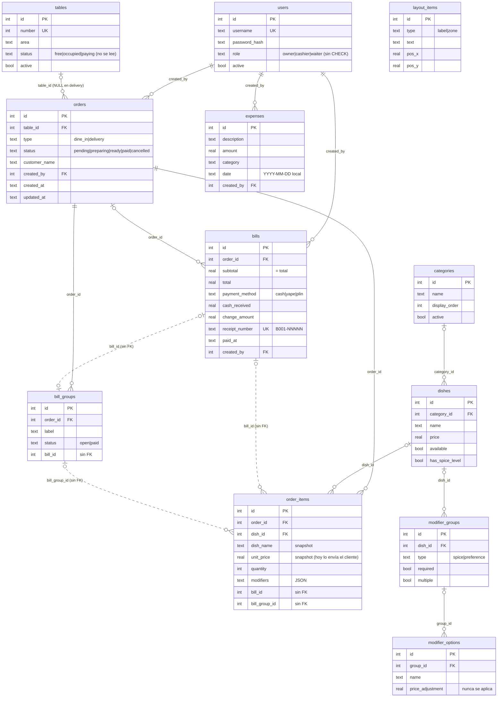
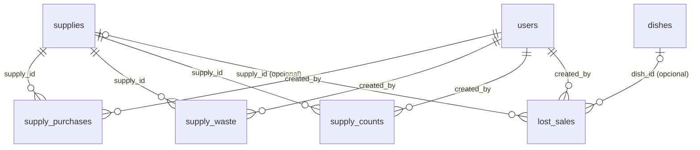
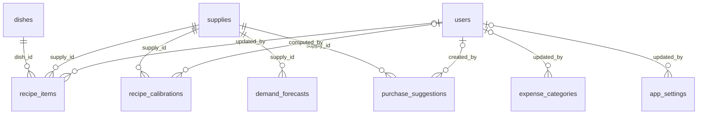

# Modelo de datos

> Parte de la [documentación de arquitectura](README.md). Snapshot `main` @ `85664bb` (2026-09-23).
> Fuente: `server/src/db/schema.ts`, `server/src/db/migrate.ts` y el DDL que `drizzle-kit push` generó sobre una BD vacía durante el análisis.
> **Posterior al snapshot:** las tablas de inventario y `dishes.archived` (2026-10) están en la [§9](#9-inventario-de-insumos-2026-10-fase-0-de-la-tesis).

## 1. Motor y acceso

| Aspecto | Valor | Evidencia |
|---|---|---|
| Motor | SQLite en archivo local | `server/.env.example` (`DATABASE_URL=file:./mauidisk.db`) |
| Driver | `@libsql/client` 0.17.3 | `server/src/db/index.ts:7-9` |
| ORM | Drizzle ORM 0.45.2 (query builder; sin repositorios) | `server/src/db/index.ts:11` |
| Claves foráneas | **Se aplican.** `PRAGMA foreign_keys` = 1 por defecto en `@libsql/client`; un insert huérfano falla con `SQLITE_CONSTRAINT` | Verificación V1 ([testing.md](testing.md#5-verificaciones-ejecutadas-durante-el-análisis)) |
| Concurrencia | Dos transacciones de escritura simultáneas en el mismo proceso no se encolan: la segunda falla de inmediato con `SQLITE_BUSY`. No se configura `busy_timeout`. El mecanismo interno de conexiones de `@libsql/client` no se verificó | Verificación V2 |
| Modo de journal | No se configura explícitamente. Valor efectivo en producción: **no determinado con la evidencia disponible** | `server/src/db/index.ts` |
| Zona horaria de timestamps | UTC (`datetime('now')` → `'YYYY-MM-DD HH:MM:SS'`) | `schema.ts` (defaults `created_at`, `paid_at`) |

## 2. Diagrama entidad-relación

Las líneas punteadas, marcadas `(sin FK)`, son relaciones que el código usa pero que **no** están declaradas como clave foránea.

## 3. Tablas

### 3.1 Ventas

**`orders`**: pedido (mesa o delivery). `schema.ts:76-88`.

| Columna | Tipo | Nulo | Default | Notas |
|---|---|---|---|---|
| id | INTEGER PK AI | no | | |
| table_id | INTEGER FK → tables | sí | | NULL en delivery. No hay unicidad de "pedido activo por mesa" (TD-04, TD-19) |
| type | TEXT | no | | `dine_in` \| `delivery` (solo en TS) |
| status | TEXT | sí | `pending` | `pending` \| `preparing` \| `ready` \| `paid` \| `cancelled`. En la práctica: `pending`, `preparing` (usado como "por cobrar"), `paid`, `cancelled` (TD-08) |
| customer_name / customer_phone / customer_address | TEXT | sí | | Datos del cliente de delivery; no existe entidad cliente (GAP-06) |
| notes | TEXT | sí | | |
| created_by | INTEGER FK → users | sí | | |
| created_at | TEXT | sí | `datetime('now')` | UTC `YYYY-MM-DD HH:MM:SS` |
| updated_at | TEXT | sí | `datetime('now')` | La app lo sobrescribe con `toISOString()` (formato distinto, TD-25). DELETE (cancelar) no lo actualiza |

**`order_items`**: línea de pedido; también es el detalle de la boleta. `schema.ts:90-103`.

| Columna | Tipo | Nulo | Default | Notas |
|---|---|---|---|---|
| order_id | INTEGER FK → orders | sí | | Siempre se completa, pero la columna admite NULL |
| dish_id | INTEGER FK → dishes | sí | | |
| dish_name | TEXT | no | | Snapshot del nombre: **lo envía el cliente** (TD-01) |
| unit_price | REAL | no | | Snapshot del precio: **lo envía el cliente** (TD-01) |
| quantity | INTEGER | sí | 1 | Sin `CHECK > 0` en BD (Zod exige 1–999) |
| modifiers | TEXT (JSON) | sí | `'[]'` | Array `{groupId, groupName, optionId?, optionName?, freeText?}` |
| notes | TEXT | sí | | Nota para cocina |
| status | TEXT | sí | `pending` | `pending` \| `preparing` \| `ready`; vestigio de la pantalla de cocina retirada |
| kitchen_printed | INTEGER (bool) | sí | 0 | Se pone en 1 al imprimir la comanda; no se muestra en la UI (TD-17) |
| bill_id | INTEGER | sí | | Boleta que cobró el ítem. **Sin FK** |
| bill_group_id | INTEGER | sí | | Sub-cuenta asignada. **Sin FK** |

**`bills`**: boleta = registro contable de la venta y del pago. `schema.ts:114-125`.

| Columna | Tipo | Nulo | Notas |
|---|---|---|---|
| order_id | INTEGER FK → orders | sí | Una orden puede tener N boletas (cobros parciales o divididos) |
| subtotal, total | REAL | no | Siempre iguales: no hay descuentos ni impuestos (GAP-03, GAP-04) |
| payment_method | TEXT | no | `cash` \| `yape` \| `plin`. Un solo método por boleta (no hay pagos mixtos) |
| cash_received, change_amount | REAL | sí | Solo en efectivo |
| receipt_number | TEXT UNIQUE | no | `B001-NNNNN`, generado en el servidor como `MAX+1` dentro de la transacción (`billing.service.ts:99-104`) |
| paid_at | TEXT | sí | `datetime('now')` UTC |
| created_by | INTEGER FK → users | sí | Cajero |

No hay columnas de estado ni de anulación (GAP-02).

**`bill_groups`**: sub-cuentas de una cuenta dividida. `schema.ts:105-112`. `order_id` NOT NULL FK; `status` `open|paid`; `bill_id` (sin FK) apunta a la boleta que la cerró.

### 3.2 Catálogo

| Tabla | Propósito | Notas |
|---|---|---|
| `categories` (`schema.ts:14-19`) | Categorías del menú | `active` filtra el menú del POS. Borrado físico si no tiene platos (`menu.ts:75-87`) |
| `dishes` (`schema.ts:21-30`) | Platos | `price` REAL. `available=false` sirve tanto para "agotado" como para "eliminado con historial" (TD-31). *Desde 2026-10: `archived` separa la baja del agotado (§9)*. No hay SKU ni código de barras |
| `modifier_groups` (`schema.ts:32-40`) | Grupos por plato: `spice` (obligatorio, único) y `preference` (texto libre) | Se crean automáticamente al dar de alta un plato con `hasSpiceLevel` (`menu.ts:109-123`) |
| `modifier_options` (`schema.ts:42-48`) | Opciones (5 niveles de picante) | `price_adjustment` existe pero **nunca se suma al precio** (TD-31) |

### 3.3 Salón

| Tabla | Propósito | Notas |
|---|---|---|
| `tables` (`schema.ts:50-61`) | Mesas | `number` UNIQUE es el número visible; `id` es la clave técnica (TD-06). `status` se escribe pero la UI deriva el estado de los pedidos activos (TD-08). `active=false` = inhabilitada |
| `layout_items` (`schema.ts:65-74`) | Decoraciones del plano (etiquetas, zonas) | Se reemplazan completas en cada guardado (`tables.ts:133-146`) |

### 3.4 Administración

| Tabla | Propósito | Notas |
|---|---|---|
| `users` (`schema.ts:4-12`) | Usuarios y roles | `password_hash` bcrypt (costo 10). `role` sin `CHECK`. `active=false` impide el login, pero no invalida tokens emitidos (TD-13) |
| `expenses` (`schema.ts:127-136`) | Gastos | `date` en día local `YYYY-MM-DD`; `category` libre (la UI ofrece 5 valores). Borrado **físico** (`reports.ts:122-129`) |

## 4. Restricciones e índices

| Tipo | Objeto | Origen |
|---|---|---|
| PRIMARY KEY AUTOINCREMENT | todas las tablas (`id`) | `schema.ts` |
| UNIQUE | `users.username`, `tables.number`, `bills.receipt_number` | `schema.ts:7`, `52`, `122` |
| FOREIGN KEY (se aplica) | `dishes.category_id`, `modifier_groups.dish_id`, `modifier_options.group_id`, `orders.table_id`, `orders.created_by`, `order_items.order_id`, `order_items.dish_id`, `bill_groups.order_id`, `bills.order_id`, `bills.created_by`, `expenses.created_by` | `schema.ts` (`.references`), todas con `ON DELETE NO ACTION` |
| Sin FK | `order_items.bill_id`, `order_items.bill_group_id`, `bill_groups.bill_id` | `schema.ts:101-102`, `110` |
| CHECK | **Ninguno.** Los enums de Drizzle solo existen en TypeScript | DDL generado |
| Índices | `idx_order_items_order_id`, `idx_order_items_bill_id`, `idx_bills_paid_at`, `idx_orders_table_status` | `migrate.ts:42-52`. No están declarados en `schema.ts`: **`drizzle-kit push` los elimina** y reaparecen en el siguiente arranque (TD-18, verificado) |

## 5. Borrado lógico, historial y auditoría

| Entidad | Estrategia | Evidencia |
|---|---|---|
| users | Lógico (`active`) | `users.ts:71-105` |
| tables | Lógico si tiene pedidos; físico si no tiene | `tables.ts:83-110` |
| dishes | Lógico (`available=false`) si aparece en pedidos; físico (incluidos sus modificadores) si no. *Desde 2026-10: lógico con `archived=true` (§9)* | `menu.ts:143-160` |
| categories | Físico (bloqueado si tiene platos) | `menu.ts:75-87` |
| orders | Lógico (`status='cancelled'`) | `orders.ts:346-355` |
| bill_groups abiertos | Físico al rehacer o deshacer la división | `split.ts:91`, `144` |
| expenses, layout_items, modifier_options | Físico | `reports.ts:122-129`, `tables.ts:134`, `menu.ts:182-186` |
| bills | No se borran ni se anulan (no hay endpoint) | — |

**Auditoría:** solo `created_by` y `created_at` en `orders`, `bills` y `expenses`. No hay `updated_by`, `cancelled_by` ni tabla de eventos (TD-16).

**Precio histórico:** correcto por diseño. `order_items` guarda `dish_name` y `unit_price` al momento del pedido, así que cambiar el menú no altera las boletas pasadas. El problema está en el **origen** de ese snapshot (TD-01), no en el mecanismo.

## 6. Mapa de la cadena de venta de un POS

| Concepto POS | Implementación en MauiDesk | Estado |
|---|---|---|
| Venta | `orders` (pedido operativo) + `bills` (venta contable). Una orden puede generar varias boletas | Implementado con otro modelo |
| Detalle de venta | `order_items`, vinculado a su boleta por `bill_id` | Implementado (sin FK en `bill_id`) |
| Producto | `dishes` + `categories` + modificadores | Implementado |
| Inventario | — | **No existe** (GAP-05) |
| Pago | Columnas de `bills` (`payment_method`, `cash_received`, `change_amount`) | Parcial: un método por boleta, sin pagos mixtos ni tabla de pagos |
| Caja | — | **No existe** (GAP-01) |
| Usuario | `users`; `created_by` en `orders`, `bills` y `expenses` | Implementado |
| Cliente | Columnas `customer_*` en `orders` | **No existe** como entidad (GAP-06) |

## 7. ¿El modelo garantiza consistencia?

| Invariante | ¿Quién la garantiza? | Estado |
|---|---|---|
| Número de boleta único y correlativo | BD (UNIQUE) + transacción (`MAX+1`) + reintento ×3 | ✅ |
| Un ítem se cobra una sola vez | App, sin guardia en el `UPDATE` | ❌ TD-03 (verificado) |
| Pedido `paid` ⇔ todos sus ítems tienen `bill_id` | App, dentro de la transacción de cobro | ✅ vía cobro · ❌ `PATCH status=paid` lo evade (TD-02) |
| Total de la boleta = Σ ítems cobrados | App al insertar; no se revalida | ✅ al crear (con precios del cliente, TD-01) |
| Un pedido activo por mesa | App, `SELECT` + `INSERT` sin transacción | ❌ TD-04 |
| Sub-cuenta `paid` ⇔ sus ítems cobrados | App, dentro de la transacción de cobro | ✅ |
| Referencias pedido/ítem/usuario válidas | BD (FK aplicadas) | ✅ |
| Referencias ítem→boleta y grupo→boleta válidas | Nadie | ❌ TD-19 |
| Estados y roles válidos | Zod en la entrada; la BD acepta cualquier texto | ⚠️ TD-19 |
| Estado de mesa coherente | Columna desnormalizada que la UI no lee | ⚠️ TD-08 |
| Montos exactos | REAL + `roundMoney` solo al cobrar | ⚠️ TD-29 |

**Conclusión:** el modelo relacional es adecuado para el alcance actual y preserva el precio histórico, pero **no garantiza por sí mismo** las invariantes centrales de una venta. Varias dependen de código de aplicación incompleto (TD-01..04) y la BD no tiene restricciones que las respalden (TD-19).

## 8. Migraciones y seed

- **Esquema base:** `npm run db:push` (`drizzle-kit push`) aplica `schema.ts` directamente, sin archivos de migración versionados. `drizzle.config.ts:7` declara `out: './src/db/migrations'`, pero la carpeta no existe.
- **Migraciones al arrancar** (`migrate.ts`): agrega `tables.active`, crea `layout_items` si falta y crea 4 índices. Son idempotentes. Si fallan, `index.ts:124-127` **arranca el servidor igual** ("WITHOUT migrations").
- **Seed** (`seed.ts`): solo si `categories` está vacía. Crea 3 usuarios con contraseñas conocidas (`admin123`, `cajero123`, `mozo123`), 5 categorías, 12 platos con modificadores y 15 mesas (ids 1–15 = números 1–15).
- **Tests:** usan su propio DDL (`__tests__/helpers/db.ts`), que no incluye FK ni las tablas de menú y plano (TD-26).

## 9. Inventario de insumos (2026-10, Fase 0 de la tesis)

Plan: [docs/plan-inventario-tesis.md](../plan-inventario-tesis.md). Fase 0 = solo **registro**: no hay stock teórico, recetas ni alertas. La Capa 2 los calculará a partir de estas mismas tablas, sin cambiar cómo se registran.

| Tabla | Propósito | Notas |
|---|---|---|
| `supplies` | Catálogo de insumos | `name` UNIQUE (y único sin distinguir mayúsculas en el servicio). `unit` `kg`/`unit`/`l`. `critical` = entra al conteo de cierre y al estudio. `active=false` lo oculta sin perder historial (no se borra) |
| `supply_purchases` | Compras | `quantity` en la unidad del insumo; `total_cost` = lo pagado (precio unitario = total / cantidad). `purchased_at` es **día local** `YYYY-MM-DD` |
| `supply_waste` | Merma | `reason` = causa (`deterioro`, `sobra_comensal`, `preparacion`, `otro`). `wasted_at` día local |
| `supply_counts` | Conteo físico al cierre | Índice único `uq_supply_counts_supply_day (supply_id, counted_on)`: un conteo por insumo y día; volver a guardarlo lo corrige. `counted_on` día local. Admite 0 |
| `lost_sales` | "Pidieron X y no había" | `dish_id` y/o `supply_id` (al menos uno, validado en el schema). `occurred_at` en **UTC** como el resto de timestamps |
| `dishes.archived` | Baja de un plato con historial | `available=false` queda solo para "agotado": así `audit_log` con `action='dish.availability'` mide quiebres sin mezclar bajas (TD-31) |

**Plan v2 (instrumento congelado, [diccionario](../diccionario-datos-tesis.md)):**

| Cambio | Detalle |
|---|---|
| `supplies.code`, `supplies.sort_order` | Código estable (`CALAMAR`, índice único `supplies_code_unique`; generado desde el nombre para los insumos de la v1, no editable) y orden en la «Compra del día» |
| `supply_purchases.supplier` | Proveedor opcional |
| `source`, `source_date` en compras y merma | `daily` (lo creó la «Compra del día» de `source_date`) o `manual`. Permite reemplazar solo lo suyo al corregir |
| `supply_counts.moment` | `apertura` (instrumento) o `cierre`. Los conteos anteriores a la v2 quedaron como `cierre` (eran pruebas). Índice único `uq_supply_counts_day_moment (supply_id, counted_on, moment)` reemplaza a `uq_supply_counts_supply_day` |
| `local_id` (`DEFAULT 1 NOT NULL`) | En compras, merma, conteos, ventas perdidas y notas. No se muestra en la UI |
| `day_notes` | Variables de control por día (`feriado`, `cerrado`, `evento`, `proveedor`, `otro`) |

**Índices** (declarados también en `schema.ts`): `idx_supply_purchases_purchased_at`, `idx_supply_waste_wasted_at`, `idx_lost_sales_occurred_at`, `idx_day_notes_date`, `uq_supply_counts_day_moment`, `supplies_name_unique`, `supplies_code_unique`. Todas las FK con `ON DELETE NO ACTION`.

**Auditoría:** correcciones y borrados de compras y merma (`purchase.update/delete`, `waste.update/delete`, con motivo y el registro anterior), correcciones de conteos (`count.update`, solo si cambia el valor), cambios del catálogo (`supply.update`) y bajas de platos (`dish.archive`). `dish.availability` se escribe solo en transiciones reales del estado "agotado".

**Indicadores que habilita** (para la línea base de la tesis): compras y su costo por insumo y día, merma por causa, existencia física al cierre, ventas perdidas por plato y quiebres por plato. Exportables como CSV con `GET /api/inventory/export` ([api.md §6](api.md#6-inventario-de-insumos-2026-10-fase-0-de-la-tesis)).

**Plan v3, entrega E1 (instrumento final):**

| Cambio | Detalle |
|---|---|
| `supplies.study_group` | **Obsoleto desde T2** (el estudio por grupos se retiró): la columna sigue en la base, sin uso (RNF07) |
| `entry_mode` | `typed`, `copied` o `default` en `supply_counts`, `supply_waste` y `supply_purchases`; `price_entry_mode` en `supply_purchases`. Null en los registros anteriores a la v3 |
| `study_config` | **Obsoleta desde T2**: la tabla sigue en la base, sin uso. La apertura del segundo local pasó a `app_settings` |
| `daily_parts` | Una fila por guardado de cada parte de la «Compra del día» (`apertura`, `compra`): autor, hora, `duration_ms`, `is_correction`, `client_version`. Índice `idx_daily_parts_date_part (date, local_id, part)` |
| `supply_transfers` | Traslados: cada local registra su lado (`envio` / `recepcion`), con `other_local_id` y costo unitario opcional en la recepción |
| `other_supply_costs` | Monto del día en insumos no críticos; único `uq_other_supply_costs_day (date, local_id, source)` |
| `day_notes.kind` | Admite `dueno_ausente` (solo cambia el enum de Drizzle y Zod) |
| `local_id` | Sale de `MAUI_LOCAL_ID` en todo lo nuevo (cada local tiene su instancia y su base) |

La «Compra del día» guarda «Botaste» también en 0 (`supply_waste` con `quantity = 0` y modo `typed` o `default`): distingue «no boté nada» de «no lo toqué».

**Migración:** pasos **requeridos** de `migrate.ts`: 5 (tablas v1), 6 (v2: columnas, códigos, `moment` + marcado `cierre` en una sola transacción, cambio del índice único y `day_notes`) y 7 (v3: `study_group` por código, modos de entrada, `study_config`, `daily_parts`, `supply_transfers`, `other_supply_costs` y su índice único). Los índices por fecha son opcionales. El único cambio no aditivo es el reemplazo del índice único de conteos. Todo aditivo: la versión anterior del código funciona con la BD nueva. `seed.ts` carga 9 insumos iniciales solo si `supplies` está vacía, aunque el menú ya exista.

## 10. Incrementos 2 y 3 de la tesis (plan-sistema T2, T3, T7 y T13)

Todo aditivo (RNF07) y con pasos idempotentes en `migrate.ts` (8, 8b y 8c). Cada local tiene su base (RD06); las tablas nuevas que registran hechos llevan `local_id`.

| Tabla o columna | Propósito | Notas |
|---|---|---|
| `app_settings` (T2) | Ajustes del local, clave → valor | `second_local_opened_on` habilita los traslados. Solo el dueño (`settings.update`) |
| `daily_parts.no_purchase` (T3) | «Hoy no compré» | No crea compras en 0: la «Compra del día» muestra 0 con modo `default` |
| `supplies.yield`, `shelf_life_days`, `service_level` (T7) | Rendimiento (kg limpios por kg comprado, 1 por defecto), vida útil y nivel de servicio | La migración los pone a los cuatro críticos solo si no están configurados |
| `recipe_items` (T7) | Gramos de producto limpio por porción de cada insumo crítico | Único `uq_recipe_items_dish_variant_supply (dish_id, variant, supply_id)`. `variant` = `''` para la receta del plato o el nombre de la opción de modificador que la reemplaza (no NULL: SQLite trataría cada NULL como distinto) |
| `recipe_calibrations` (T7) | Factor de la Fórmula 12 por local e insumo, con su periodo | El vigente es el de mayor `id`. Índice `idx_recipe_calibrations_local_supply` |
| `expense_categories` (T7) | Tipo de cada categoría de gasto | `CHECK (kind IN ('fijo','variable'))`. Sin fila = fija. Gas y descartables, variables |
| `demand_forecasts` (T13) | Pronóstico por local, insumo, noche y día objetivo (horizonte 1 a 3) | Único `uq_demand_forecasts_night (local_id, supply_id, made_on, target_date)`: requerido, garantiza RD04. `sigma_h` = σ del error acumulado de su horizonte |
| `purchase_suggestions` (T13) | Cada cantidad sugerida mostrada, con sus componentes | `available_source` (`conteo`/`teorico`). Índice `idx_purchase_suggestions_date` |
| `forecast_runs` (T13) | Ejecuciones de la tarea nocturna o a pedido | `status` `running`/`ok`/`error`. Índice `idx_forecast_runs_made_on` |

La rentabilidad **no se guarda**: se calcula al consultarla desde las tablas de registro. Las ventas salen de `order_items` de boletas pagadas (por `bill_id`), sin los pedidos cancelados, en el día local `date(paid_at, '-5 hours')`.
