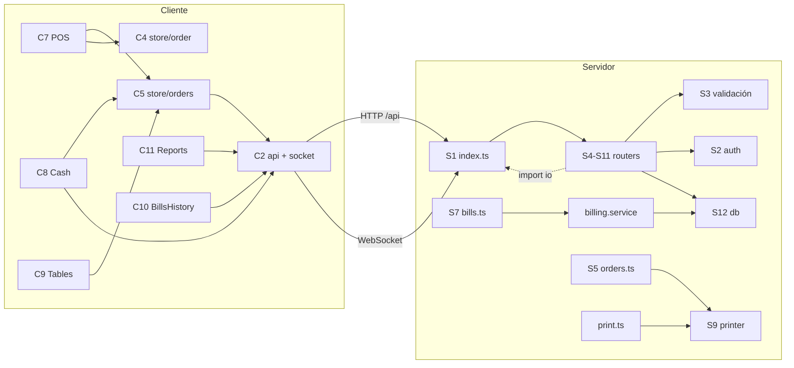

# Inventario de módulos

> Parte de la [documentación de arquitectura](README.md). Snapshot `main` @ `85664bb` (2026-09-23).
> Los módulos se identificaron siguiendo las importaciones y las llamadas reales, no los nombres de carpetas.

**Clasificación:** **Completo** (cumple su responsabilidad de punta a punta) · **Parcial** (falta funcionalidad o tiene defectos que afectan su propósito) · **Experimental** · **Obsoleto** (reemplazado o retirado, pero con código presente) · **Sin uso aparente** (no lo usa ningún consumidor). No se encontraron módulos experimentales.

---

## 1. Módulos funcionales del POS

| Módulo | Estado | Responsabilidad | Componentes principales |
|---|---|---|---|
| Ventas (pedidos + cobro) | **Parcial** | Tomar pedidos por mesa o delivery, cobrar total/parcial/dividido, emitir boleta interna | `client/src/pages/POS.tsx`, `Cash.tsx`; `server/src/routes/orders.ts`, `split.ts`, `bills.ts`; `services/billing.service.ts` |
| Productos (menú) | **Parcial** | Catálogo de platos con categorías y modificadores | `client/src/pages/admin/MenuAdmin.tsx`; `server/src/routes/menu.ts` |
| Inventario | **No existe** | — | — |
| Caja | **No existe** (la pantalla "Caja" es el cobro) | — | — |
| Usuarios | **Completo** con brechas de seguridad | Login, roles, administración de cuentas | `client/src/pages/Login.tsx`, `admin/Users.tsx`; `server/src/routes/auth.ts`, `users.ts`, `middleware/auth.ts` |
| Clientes | **No existe** (solo datos de delivery en el pedido) | — | Columnas `customer_*` de `orders` |
| Reportes | **Parcial** | Ventas por período y método, top platos, serie diaria, gastos, balance, exportación CSV/HTML | `client/src/pages/Reports.tsx`, `BillsHistory.tsx`, `utils/reportHTML.ts`; `server/src/routes/reports.ts` |
| Configuración | **No existe** como módulo (hardcodeada o en `.env`) | — | `server/.env.example`, constantes en `printer.ts` y `billing.service.ts` |
| Mesas y plano *(adicional)* | **Completo** | Mesas, zonas, plano editable, estado ocupada/libre | `client/src/pages/Tables.tsx`; `server/src/routes/tables.ts` |
| Impresión *(adicional)* | **Completo** con brechas | Comanda, pre-cuenta, boleta, reimpresión, diagnóstico | `server/src/utils/printer.ts`, `routes/print.ts`; `client/src/components/PrinterStatus.tsx` |

### Detalle por sub-funcionalidad

**Ventas**

| Funcionalidad | Estado | Evidencia |
|---|---|---|
| Crear venta (pedido) | ✅ | `orders.ts:114-170` |
| Carrito / borrador | ✅ persistido en `localStorage` | `client/src/store/order.ts` |
| Agregar/eliminar productos (antes de enviar) | ✅ | `store/order.ts:42-50` |
| Eliminar productos ya enviados | ❌ | No hay endpoint para borrar ítems |
| Descuentos | ❌ | GAP-03 |
| Impuestos | ❌ | GAP-04 (`subtotal = total`) |
| Métodos de pago | ⚠️ efectivo, Yape, Plin fijos; uno por boleta; sin pagos mixtos | `schema.ts:119`, `Cash.tsx:15-19` |
| Cálculo de totales | ⚠️ servidor al cobrar, sobre precios del cliente | `billing.service.ts:80` (TD-01) |
| Cobro parcial y cuenta dividida | ✅ | `billing.service.ts:35-76`, `split.ts` |
| Anulación / cancelación | ⚠️ cancelar pedido sin controles; anular boleta no existe | TD-02, GAP-02 |
| Devoluciones | ❌ | GAP-02 |
| Historial de ventas | ✅ | `BillsHistory.tsx`, `GET /api/bills` |
| Comprobantes | ⚠️ ticket interno "Boleta B001-NNNNN"; no electrónico | `printer.ts:335-400`, GAP-04 |

**Productos**

| Funcionalidad | Estado | Evidencia |
|---|---|---|
| CRUD de platos | ⚠️ alta, precio, disponibilidad y baja en la UI; nombre, descripción y categoría solo por API | `MenuAdmin.tsx:46-110`, `menu.ts:90-160` |
| Categorías | ⚠️ solo API (sin UI) | `menu.ts:50-87` |
| Precios | ✅ en catálogo · ❌ no se aplican al vender (TD-01) | |
| Variantes / modificadores | ⚠️ picante (opción) + preferencia (texto); `priceAdjustment` no se aplica | `menu.ts:109-123`, TD-31 |
| Código de barras / SKU | ❌ | No hay columnas |
| Activo/inactivo | ⚠️ `available` mezcla "agotado" y "eliminado" | TD-31 |

**Inventario:** stock, entradas, salidas, ajustes, movimientos, kardex, descuento automático al vender y control de stock negativo → **ninguno existe** (GAP-05).

**Caja:** apertura, cierre, movimientos, ingresos, egresos, arqueo, diferencias e historial → **ninguno existe** (GAP-01). Los gastos (`expenses`) son el único registro de egresos y no están vinculados a una caja.

**Usuarios**

| Funcionalidad | Estado | Evidencia |
|---|---|---|
| Registro (alta por el dueño) | ✅ | `users.ts:48-68` |
| Roles | ✅ 3 fijos | `schema.ts:9` |
| Permisos granulares | ❌ solo por rol | `middleware/auth.ts:34-42` |
| Autenticación | ✅ JWT 12 h | `auth.ts` |
| Autorización | ⚠️ incompleta en pedidos | TD-02 |
| Sesiones | ⚠️ sin revocación ni cierre en el servidor | TD-13 |
| Auditoría | ❌ | TD-16 |

**Clientes:** CRUD, historial de compras → ❌. Solo se guardan nombre, teléfono y dirección en cada pedido de delivery (GAP-06).

**Reportes**

| Funcionalidad | Estado | Evidencia |
|---|---|---|
| Ventas (hoy / 7 días / mes) | ✅ | `reports.ts:16-56` |
| Productos (top platos) | ⚠️ sobrecuenta en cuentas divididas | TD-09 |
| Inventario | ❌ | — |
| Caja | ⚠️ solo totales por método | `reports.ts:24-28` |
| Usuarios / cajeros | ❌ | GAP-09 |
| Utilidades | ⚠️ "Balance neto" = ventas − gastos, sin costo de ventas | `Reports.tsx:172-173` |
| Diario / mensual | ⚠️ serie diaria agrupada en UTC | TD-10 |
| Exportación | ✅ CSV y HTML imprimible (este último con XSS, TD-05) | `Reports.tsx:68-126`, `reportHTML.ts` |

**Configuración:** datos del negocio (hardcodeados en `printer.ts:345-347`), impuestos (no existen), métodos de pago (enum en código), numeración (serie `B001` fija en `billing.service.ts:104`), parámetros del POS (`.env`: puerto, CORS, BD, impresora) → sin módulo de configuración (GAP-07).

---

## 2. Módulos técnicos: servidor

### S1. Bootstrap del servidor
- **Ubicación:** `server/src/index.ts`
- **Responsabilidad:** validar `JWT_SECRET`, configurar CORS, crear el servidor HTTP y Socket.io, autenticar sockets, montar los routers, servir `client/dist` con fallback SPA, correr las migraciones y escuchar en el puerto.
- **Dependencias internas:** todos los routers, `db/migrate`, `middleware/auth` (tipo). **Externas:** express, socket.io, cors, jsonwebtoken, dotenv.
- **Consumidores:** `orders.ts`, `split.ts` y `bills.ts` importan `io` desde aquí (dependencia circular, TD-20).
- **Estado:** **Completo**. **Observaciones:** arranca aunque fallen las migraciones (`index.ts:124-127`); sin manejador global de errores (TD-21).

### S2. Autenticación y autorización
- **Ubicación:** `server/src/routes/auth.ts`, `server/src/middleware/auth.ts`, `server/src/schemas/auth.ts`
- **Responsabilidad:** login con bcrypt, emisión de JWT, `requireAuth`, `requireRole`.
- **Externas:** bcryptjs, jsonwebtoken. **Endpoints:** `POST /api/auth/login`, `GET /api/auth/me`. **Entidades:** `users`.
- **Consumidores:** todos los routers.
- **Estado:** **Parcial**: funciona, pero sin revocación ni límite de intentos (TD-13, TD-15).

### S3. Validación
- **Ubicación:** `server/src/middleware/validate.ts`, `server/src/schemas/*.ts`
- **Responsabilidad:** `validateBody` y `validateQuery` con Zod; un schema por recurso.
- **Externas:** zod 4.4.3. **Consumidores:** todos los routers con body.
- **Estado:** **Completo**. **Observaciones:** `validateQuery` no reemplaza `req.query` y los handlers leen el valor sin parsear (seguro porque ya se validó). Los parámetros de ruta no se validan. `schemas/print.ts` reconoce que valida datos que deberían venir del servidor.

### S4. Menú
- **Ubicación:** `server/src/routes/menu.ts`, `server/src/schemas/menu.ts`
- **Responsabilidad:** menú para el POS y administración de categorías, platos y modificadores.
- **Endpoints:** 11 (ver [api.md](api.md#menú-routesmenuts)). **Entidades:** `categories`, `dishes`, `modifier_groups`, `modifier_options`, `order_items` (para decidir el borrado lógico).
- **Consumidores:** `POS.tsx` (`GET /menu`), `MenuAdmin.tsx`.
- **Estado:** **Parcial**: 6 de 11 endpoints sin UI; `priceAdjustment` sin efecto; alta de plato no transaccional.

### S5. Pedidos
- **Ubicación:** `server/src/routes/orders.ts`, `server/src/schemas/orders.ts`
- **Responsabilidad:** crear pedidos, agregar ítems, cambiar estado, cancelar, disparar la comanda automática, serializar el pedido y emitir eventos.
- **Dependencias:** `db`, `index.ts` (`io`), `utils/printer`. **Endpoints:** 9. **Entidades:** `orders`, `order_items`, `tables`, `bill_groups`.
- **Consumidores:** `store/orders.ts` (POS, Tables, Cash).
- **Estado:** **Parcial**: precios del cliente, sin máquina de estados, sin rol para cancelar, sin transacciones (TD-01, 02, 04, 07). Contiene endpoints **obsoletos** de la pantalla de cocina (`toggle`, `ready`).

### S6. División de cuenta
- **Ubicación:** `server/src/routes/split.ts`, `server/src/schemas/split.ts`
- **Responsabilidad:** crear, reemplazar y deshacer sub-cuentas (`bill_groups`) preservando las pagadas.
- **Endpoints:** GET/POST/DELETE `/api/orders/:id/split`. **Entidades:** `bill_groups`, `order_items`, `orders`.
- **Consumidores:** `store/orders.ts` (`saveSplit`, `deleteSplit`), usados en `Cash.tsx`.
- **Estado:** **Completo**. **Observaciones:** valida fuera de la transacción; `DELETE` sin transacción (TD-23); duplica la serialización del pedido.

### S7. Cobro y boletas
- **Ubicación:** `server/src/routes/bills.ts`, `server/src/services/billing.service.ts`, `server/src/schemas/bills.ts`, `server/src/utils/math.ts`
- **Responsabilidad:** registrar cobros (4 modos) en una transacción, numerar boletas, cerrar el pedido y liberar la mesa; historial y detalle de boletas.
- **Dependencias:** `db`, `index.ts` (`io`), `utils/dates`, `utils/math`. **Endpoints:** 4. **Entidades:** `bills`, `order_items`, `bill_groups`, `orders`, `tables`, `users`.
- **Consumidores:** `Cash.tsx`, `BillsHistory.tsx`.
- **Estado:** **Completo** (único módulo con capa de servicio y tests). **Observaciones:** doble cobro posible por lecturas fuera de la transacción (TD-03) y 500 ante `SQLITE_BUSY` (TD-11). `GET /next-number` está **sin uso**.

### S8. Reportes y gastos
- **Ubicación:** `server/src/routes/reports.ts`, `server/src/schemas/reports.ts`, `server/src/utils/dates.ts`
- **Responsabilidad:** agregados de ventas, listado de boletas del período y CRUD de gastos.
- **Endpoints:** 6. **Entidades:** `bills`, `orders`, `order_items`, `expenses`.
- **Consumidores:** `Reports.tsx`.
- **Estado:** **Parcial**: agregaciones incorrectas (TD-09, TD-10); la edición y el borrado de gastos no tienen UI.

### S9. Impresión
- **Ubicación:** `server/src/utils/printer.ts`, `server/src/utils/logo_bitmap.ts` (generado), `server/src/routes/print.ts`, `server/src/schemas/print.ts`
- **Responsabilidad:** generar ESC/POS (comanda, pre-cuenta, boleta, prueba), verificar la conectividad antes de enviar y transportar por TCP:9100 o por la cola de Windows (solo desarrollo).
- **Externas:** módulos nativos `net`, `child_process` (PowerShell). **Endpoints:** 7.
- **Consumidores:** `orders.ts` (comanda automática), `Cash.tsx`, `BillsHistory.tsx`, `PrinterStatus.tsx`.
- **Estado:** **Completo**. **Observaciones:** boleta y pre-cuenta con datos del cliente (TD-14); imprime `tableId` (TD-06); `POST /kitchen` y `GET /test` sin uso; nombre del negocio hardcodeado.

### S10. Mesas y plano
- **Ubicación:** `server/src/routes/tables.ts`, `server/src/schemas/tables.ts`
- **Responsabilidad:** CRUD de mesas con borrado lógico o físico según el historial; posiciones y decoraciones del plano.
- **Endpoints:** 6. **Entidades:** `tables`, `layout_items`, `orders`.
- **Consumidores:** `Tables.tsx`, `POS.tsx`.
- **Estado:** **Completo**. **Observaciones:** guardado del plano no transaccional; `tables.status` desnormalizado sin lectores (TD-08).

### S11. Usuarios
- **Ubicación:** `server/src/routes/users.ts`, `server/src/schemas/users.ts`
- **Responsabilidad:** alta, edición, inhabilitación y contraseñas; salvaguarda del último dueño.
- **Endpoints:** 5. **Entidades:** `users`. **Consumidores:** `admin/Users.tsx`, `ChangePasswordModal.tsx`.
- **Estado:** **Completo**.

### S12. Persistencia
- **Ubicación:** `server/src/db/index.ts`, `schema.ts`, `migrate.ts`, `seed.ts`, `server/drizzle.config.ts`
- **Responsabilidad:** cliente Drizzle/libsql, esquema, migraciones idempotentes al arrancar, datos demo.
- **Externas:** drizzle-orm, @libsql/client, drizzle-kit (dev).
- **Consumidores:** todos los routers y el servicio de cobro.
- **Estado:** **Parcial**: dos fuentes de verdad del esquema, índices que `push` elimina, sin `CHECK` ni FK en `bill_id` (TD-18, TD-19).

### S13. Utilidades de dominio
- **Ubicación:** `server/src/utils/dates.ts`, `server/src/utils/math.ts`
- **Responsabilidad:** límites de "hoy"/período en hora local serializados a UTC; redondeo monetario.
- **Consumidores:** `bills.ts`, `reports.ts`, `print.ts`, `billing.service.ts`.
- **Estado:** **Completo**. **Observaciones:** dependen de la zona horaria del proceso (TD-27).

### S14. Tiempo real
- **Ubicación:** `io` en `server/src/index.ts`; `emit` en `orders.ts`, `split.ts` y `bills.ts`
- **Responsabilidad:** difundir cambios de pedidos y resultados de impresión.
- **Externas:** socket.io 4.8.3. **Consumidores:** `client/src/store/orders.ts`.
- **Estado:** **Completo**. **Observaciones:** difusión global (TD-32).

### S15. Tests
- **Ubicación:** `server/src/__tests__/`, `server/vitest.config.ts`
- **Estado:** **Parcial**: solo el servicio de cobro ([testing.md](testing.md)).

### S16. Scripts de build
- **Ubicación:** `server/scripts/convert-logo.mjs` (Logo.jpg → `logo_bitmap.ts`), `scripts/generate-pwa-icons.js` (iconos PWA)
- **Externas:** jimp. **Estado:** **Completo** (se ejecutan a mano). **Observaciones:** `jimp` está en las dependencias de runtime del servidor (TD-30).

---

## 3. Módulos técnicos: cliente

| # | Módulo | Ubicación | Responsabilidad | Dependencias | Endpoints | Estado | Observaciones |
|---|---|---|---|---|---|---|---|
| C1 | Shell y rutas | `main.tsx`, `App.tsx`, `components/Layout.tsx`, `components/ProtectedRoute.tsx` | Router, guardas por rol, navegación lateral e inferior | react-router-dom 7, store/auth, store/orders | — | Completo | `/kitchen` redirige a `/tables` (retiro deliberado) |
| C2 | Transporte | `api/client.ts`, `api/socket.ts` | axios con token e interceptor 401 (timeout 15 s); socket con token en el handshake y estado de conexión | axios, socket.io-client, store/connection | todos | Completo | Sin resincronización al reconectar (TD-12) |
| C3 | Sesión | `store/auth.ts` | login, logout, `init` con `/auth/me` | C2 | `/auth/*` | Completo | Token en `localStorage` |
| C4 | Borrador de pedido | `store/order.ts` | Carrito persistido | zustand/persist | — | Completo | Persistir precios agrava TD-01 |
| C5 | Pedidos activos | `store/orders.ts` | Estado global de pedidos, eventos de socket, acciones de pedido y división, derivación del estado de mesa | C2, store/toast | `/orders/*`, `/orders/:id/split` | Parcial | TD-08, TD-12 |
| C6 | Toasts y conexión | `store/toast.ts`, `store/connection.ts`, `components/ToastHost.tsx`, `ReconnectBanner.tsx` | Avisos y banner de reconexión | zustand | — | Completo | |
| C7 | POS | `pages/POS.tsx` | Toma de pedidos, modificadores, delivery, agregar a pedido, cancelar | C4, C5 | `/menu`, `/tables`, `/orders` | Parcial | Sin guardia de envío (TD-04); `confirm()` nativo |
| C8 | Caja (cobro) | `pages/Cash.tsx` | Selección de pedido, sub-cuentas, cobro, boleta, pre-cuenta | C5, C3 | `/bills`, `/print/receipt`, `/print/pre-receipt`, `/orders/:id/split` | Completo | 1175 líneas (TD-22); boleta impresa con datos locales (TD-14); muestra `tableId` (TD-06) |
| C9 | Mesas | `pages/Tables.tsx` | Vista lista/plano, editor drag & drop, zonas, alta/baja de mesas | C5, C3 | `/tables/*` | Completo | 1348 líneas; la tarjeta "En caja" suma consumo de mesas abiertas, no efectivo |
| C10 | Historial | `pages/BillsHistory.tsx` | Boletas por rango, detalle, reimpresión | C2 | `/bills`, `/bills/:id`, `/print/reprint/:id` | Completo | Único lugar que convierte bien las fechas UTC |
| C11 | Reportes | `pages/Reports.tsx`, `utils/reportHTML.ts` | KPIs, gráficos (recharts), gastos, CSV, reporte HTML | recharts | `/reports/*` | Parcial | XSS (TD-05), fechas (TD-10), sin manejo de errores (TD-25) |
| C12 | Admin menú | `pages/admin/MenuAdmin.tsx` | Alta de platos, precio, disponibilidad, baja | C2, ConfirmDialog | `/menu/dishes*` | Parcial | Sin categorías ni modificadores (GAP-08) |
| C13 | Admin usuarios | `pages/admin/Users.tsx`, `components/ChangePasswordModal.tsx` | CRUD de usuarios y contraseñas | C2 | `/users/*` | Completo | |
| C14 | Estado de impresora | `components/PrinterStatus.tsx` | Indicador con sondeo cada 30 s y limpieza de cola | C2 | `/print/status`, `/print/clear-queue` | Completo | |
| C15 | Login | `pages/Login.tsx` | Formulario de acceso | C3 | `/auth/login` | Completo | |
| C16 | Tipos compartidos | `types/index.ts` | Tipos de dominio del cliente | — | — | Parcial | `Order`, `Table`, `OrderStatus`, `PaymentMethod` y `Role` no se importan; `Role` y `PayMethod` se redefinen en otros archivos. No se comparten tipos con el servidor |
| C17 | PWA | `public/manifest.webmanifest`, `public/icon-*.png`, `index.html` | App instalable (`standalone`, `start_url=/tables`) | — | — | Completo | Sin service worker (no funciona offline) |

---

## 4. Dependencias entre módulos

---

## 5. Elementos sin uso aparente

| Elemento | Tipo | Clasificación | Evidencia |
|---|---|---|---|
| `PATCH /api/orders/:id/items/:itemId/toggle`, `PATCH /api/orders/:id/ready` | Endpoints | **Obsoleto** | La pantalla de cocina se eliminó en `5200066`; `App.tsx:43` redirige `/kitchen` |
| `order_items.status`, `order_items.kitchen_printed` | Columnas | **Obsoleto** / sin lector | Solo las escriben los endpoints anteriores y la comanda; la UI muestra un estado que nunca avanza (`POS.tsx:521-524`) |
| `GET /api/bills/next-number` | Endpoint | **Obsoleto** | La numeración pasó al servidor en `e89587d` |
| `POST /api/print/kitchen`, `GET /api/print/test` | Endpoints | Sin uso aparente | Ninguna llamada en `client/src` |
| `GET /api/orders/:id`, `GET /api/orders/:id/split`, `GET /api/menu/dishes/:id/modifiers` | Endpoints | Sin uso aparente | Ídem |
| CRUD de categorías y de opciones de modificador; `PATCH`/`DELETE` de gastos | Endpoints | Sin uso aparente (backend sin UI) | GAP-08 |
| `POST /api/orders/:id/reprint-kitchen` | Endpoint | Sin uso aparente (**debería usarse**) | TD-17 |
| `@dnd-kit/core`, `@dnd-kit/sortable`, `@dnd-kit/utilities` | Dependencias del cliente | Sin uso aparente | Sin importaciones en `client/src` (las usaba `Kitchen.tsx`) |
| `client/src/assets/hero.png`, `react.svg`, `vite.svg`, `client/src/App.css`, `client/public/icons.svg` | Assets | Sin uso aparente | Sin referencias en `client/src`, `index.html` ni `public` |
| `client/README.md` | Documentación | Obsoleto | Texto de la plantilla de Vite |
| `modifier_options.price_adjustment` | Columna | Sin uso aparente | Nunca se suma al precio (TD-31) |
| `tables.status` | Columna | Escrita, sin lector | La UI deriva el estado de los pedidos (TD-08) |
| Tipos `Order`, `Table`, `OrderStatus`, `PaymentMethod`, `Role` en `types/index.ts` | Tipos | Sin uso aparente | Sin importaciones |

**Código duplicado relevante:** serialización del pedido en `orders.ts:85-96`, `split.ts:13-26` y `bills.ts:130-137`; construcción de la etiqueta de mesa en `orders.ts:30-32` y `242-244`; interfaces `Summary`/`Expense`/`BillRecord` en `Reports.tsx` y `reportHTML.ts`; `PayMethod` en `Cash.tsx` y `BillsHistory.tsx`; `Role` en `types/index.ts` y `store/auth.ts`.
