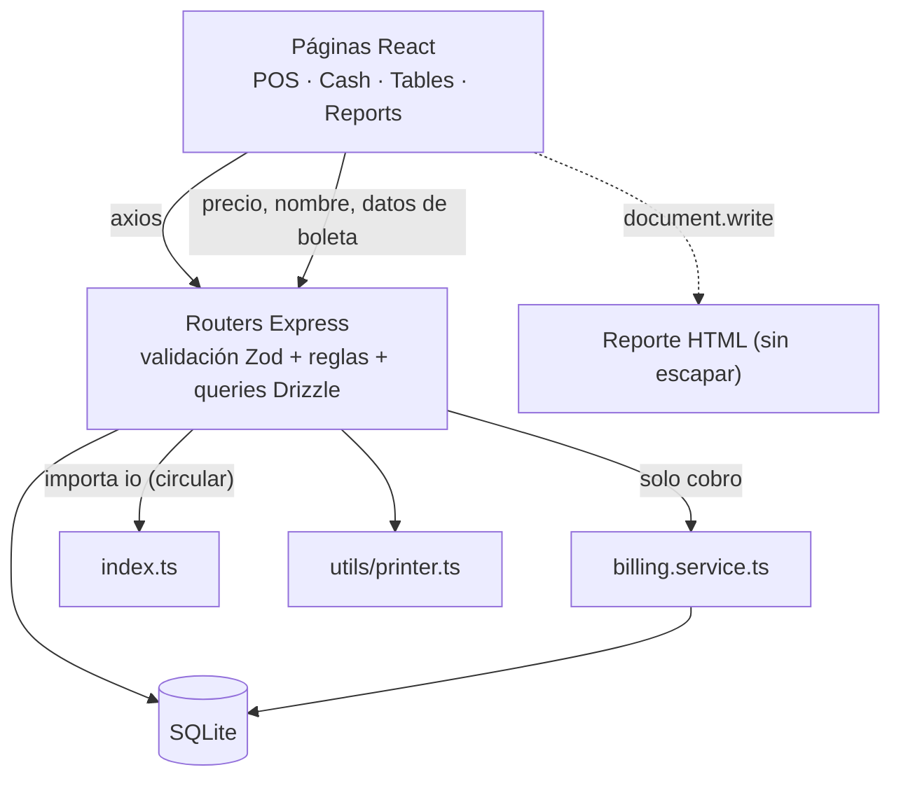
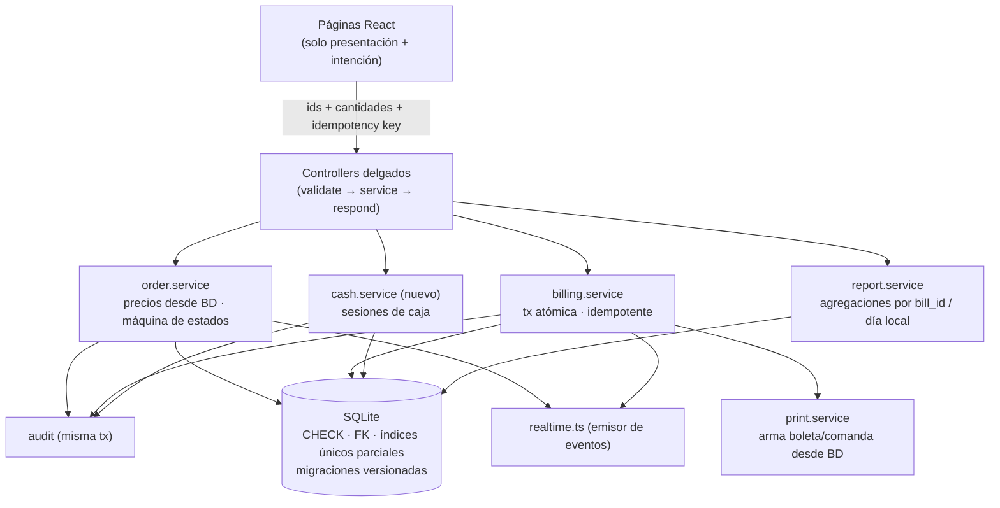

# Recomendaciones de arquitectura y mantenimiento

> Parte de la [documentación de arquitectura](README.md). Snapshot `main` @ `85664bb` (2026-09-23).
> **Todo lo que aparece aquí es una propuesta: nada está implementado.** Los problemas referenciados (`TD-xx`, `GAP-xx`) están en [technical-debt.md](technical-debt.md).

## Cómo leer las prioridades

| Prioridad | Significado |
|---|---|
| **P0** | Antes de operar con dinero real, o de inmediato si ya se está operando |
| **P1** | Próxima iteración |
| **P2** | Planificar (cambios de modelo o módulos nuevos) |
| **P3** | Cuando haya margen o si el negocio lo requiere |

Las recomendaciones siguen el orden de prioridades pedido: **integridad de ventas → inventario → caja → seguridad → mantenibilidad → escalabilidad → rendimiento**.

---

## 1. Arquitectura actual vs. recomendada

### Actual (verificada en el código)

Rasgos: la lógica de negocio está repartida entre la UI (precios, totales mostrados, datos de la boleta impresa) y los routers. Solo el cobro tiene servicio y tests. Las invariantes críticas (precio, estado del pedido, unicidad por mesa, "no cobrar dos veces") se aplican de forma parcial o no se aplican.

### Recomendada (evolución incremental, sin reescribir)

Principios: **el servidor es la única autoridad** sobre precios, totales, estados y contenido de lo impreso; **toda mutación de dinero ocurre en una transacción que revalida sus precondiciones**; **las invariantes también viven en la BD**; los routers no contienen reglas de negocio.

---

## 2. Integridad de ventas

### REC-01 — Precios autoritativos en el servidor
- **Problema:** TD-01.
- **Contexto:** en un POS, el precio lo fija el catálogo y no el dispositivo del mozo. Hoy el cliente envía `unitPrice` y `dishName`, y el servidor los persiste.
- **Evidencia:** `server/src/schemas/orders.ts:10-17`, `server/src/routes/orders.ts:139-150`, `177-188`, `client/src/store/order.ts:56`.
- **Solución propuesta:**
  1. El cliente envía solo `dishId`, `quantity`, `modifiers` (ids de opción + texto libre) y `notes`.
  2. El servidor carga los `dishes` y `modifier_options` involucrados en una sola consulta, rechaza platos inexistentes o no disponibles (409) y calcula `unitPrice = dish.price + Σ priceAdjustment` y `dishName` desde la BD.
  3. Se mantiene el *snapshot* en `order_items` (`dish_name`, `unit_price`), que ya preserva correctamente el precio histórico.
  4. Si el cliente muestra un total, es solo informativo. Opcional: aceptar `expectedUnitPrice` y responder `409 PRICE_CHANGED` con los precios vigentes para que la UI actualice el borrador.
  5. Implementarlo extrayendo `order.service.ts` (primer paso de REC-14) con tests del estilo de `billing.test.ts`.
- **Impacto esperado:** se elimina la manipulación de precios y los precios obsoletos de borradores persistidos.
- **Prioridad:** **P0**.
- **Riesgos de implementar:** los borradores guardados en `localStorage` quedarán con un formato distinto (limpiarlos o migrarlos al cargar). Hay que definir qué pasa con los modificadores de texto libre (no tienen precio).

### REC-02 — Máquina de estados del pedido y control de cancelaciones
- **Problema:** TD-02, TD-07, TD-08.
- **Contexto:** los estados `preparing`/`ready` quedaron sin uso al retirar la pantalla de cocina, `paying` no existe en la BD y cualquier rol puede cancelar o cerrar un pedido.
- **Evidencia:** `server/src/routes/orders.ts:173-227`, `282-307`, `346-355`; `server/src/schemas/orders.ts:33-35`; `client/src/pages/POS.tsx:361-366`.
- **Solución propuesta:**
  1. Definir las transiciones permitidas en `order.service`: `pending ⇄ billing_requested → paid` (solo lo alcanza `billing.service`) y `pending|billing_requested → cancelled`.
  2. Quitar `paid` de `UpdateOrderStatusSchema`: solo el cobro cierra pedidos.
  3. Cancelar requiere rol `owner`/`cashier` (o un PIN de dueño para mozos), un motivo obligatorio y **ningún ítem cobrado**. Si hay boletas, primero se anulan (REC-09).
  4. Registrar `cancelled_by`, `cancelled_at` y `cancel_reason` (o un evento de auditoría, REC-07).
  5. `POST /:id/items` y `PATCH /:id/status` verifican que el pedido exista y no esté `paid`/`cancelled` → 404/409.
  6. Persistir "por cobrar" como estado real (o columna `billing_requested_at`) y eliminar `tables.status`, o derivarlo en el servidor.
- **Impacto esperado:** ninguna venta desaparece sin rastro; el estado de la mesa es coherente en todos los dispositivos.
- **Prioridad:** **P0**.
- **Riesgos de implementar:** cambia el flujo del mozo (hoy puede cancelar sin intermediarios); requiere acordar la política con el dueño. Los datos existentes con `status` `preparing`/`ready` deben mapearse.

### REC-03 — Cobro atómico e idempotente
- **Problema:** TD-03, TD-11.
- **Contexto:** `billing.service.ts` ya concentra el cobro y tiene tests. El defecto está acotado a dónde se leen las precondiciones.
- **Evidencia:** `server/src/services/billing.service.ts:32-78`, `117-119`, `152-155`; verificaciones V2 y V5.
- **Solución propuesta:**
  1. Mover dentro de `db.transaction` la lectura del pedido, del grupo y de `targetItems`.
  2. Marcar los ítems con `UPDATE … SET bill_id = ? WHERE id IN (…) AND bill_id IS NULL RETURNING id` y abortar con `BillingError 409` si la cantidad devuelta difiere de `targetItems.length` (rollback automático).
  3. Aceptar una `idempotencyKey` generada por el cliente en cada intento de cobro (`bills.request_id UNIQUE`). Ante un duplicado, devolver la boleta existente en lugar de crear otra.
  4. Evitar `SQLITE_BUSY`: con un único proceso Node, serializar las transacciones de escritura con un mutex en memoria es suficiente y simple. Alternativa: reintentos con backoff ante `SQLITE_BUSY`, o configurar `busy_timeout` (verificar que `@libsql/client` lo aplique también a las conexiones que usan las transacciones).
  5. Agregar como tests de regresión los escenarios V2 y V5 ([testing.md](testing.md)).
- **Impacto esperado:** imposible cobrar dos veces el mismo ítem; los reintentos del cliente son seguros; no hay 500 espurios por concurrencia.
- **Prioridad:** **P0** (cambio pequeño y localizado).
- **Riesgos de implementar:** bajo. El mutex debe envolver **todas** las transacciones de escritura (cobro, división y las que se agreguen) para ser efectivo.

### REC-04 — Creación de pedidos sin duplicados
- **Problema:** TD-04.
- **Evidencia:** `client/src/pages/POS.tsx:283-327`, `562-576`; `server/src/routes/orders.ts:117-157`.
- **Solución propuesta:**
  1. En el cliente, agregar un estado `sending` que deshabilite "Enviar a cocina" y "Agregar a pedido" (como ya hace `PaymentPanel` en `Cash.tsx:621-629`).
  2. En el servidor, envolver la creación (pedido + ítems + mesa) en una transacción y crear un índice único parcial: `CREATE UNIQUE INDEX uq_orders_active_table ON orders(table_id) WHERE table_id IS NOT NULL AND status NOT IN ('paid','cancelled')`. La colisión se traduce al 409 que ya existe.
  3. Usar una `clientRequestId` por envío de ítems para que los reintentos no dupliquen.
  4. Imprimir la comanda solo después del commit (ya ocurre) y solo si la request no era un duplicado.
- **Impacto esperado:** sin comandas ni ítems duplicados; un solo pedido activo por mesa garantizado por la BD.
- **Prioridad:** **P1**.
- **Riesgos de implementar:** el índice fallará al crearse si ya existen mesas con dos pedidos activos; hay que limpiar esos datos antes.

### REC-05 — Identificar la mesa por su número
- **Problema:** TD-06.
- **Evidencia:** `server/src/utils/printer.ts:356`, `438`, `490`; `client/src/pages/Cash.tsx:120`, `393`, `1079`.
- **Solución propuesta:** incluir `tableNumber` (JOIN con `tables`) en la serialización del pedido y en los endpoints de boletas y reportes; las funciones de impresión reciben `tableNumber`. En el cliente, mostrar siempre `number`; `tableId` queda solo como clave técnica.
- **Impacto esperado:** comandas y boletas correctas aunque el dueño edite las mesas.
- **Prioridad:** **P1** (P0 si ya se borraron o recrearon mesas en producción).
- **Riesgos de implementar:** bajo.

### REC-10 — Reportes correctos
- **Problema:** TD-09, TD-10, TD-25 (`orderCount`).
- **Evidencia:** `server/src/routes/reports.ts:30-53`; `client/src/pages/Reports.tsx:202-203`; `client/src/utils/reportHTML.ts:50`.
- **Solución propuesta:**
  1. "Top platos": `JOIN bills ON order_items.bill_id = bills.id` (solo ítems cobrados, sin multiplicar).
  2. Serie diaria: agrupar por fecha local. Perú no tiene horario de verano, así que `date(paid_at, '-5 hours')` es correcto; mejor aún, derivar el desfase de `utils/dates.ts` para no fijarlo en el código.
  3. Un helper compartido en el cliente (`parseDbUtc`) que agregue `'Z'`, usado en Reportes, el reporte HTML, el CSV y el historial.
  4. Renombrar `orderCount` a `billCount`, o calcular pedidos distintos.
  5. Redondear las sumas con `roundMoney`.
- **Impacto esperado:** reportes que cuadran con las boletas.
- **Prioridad:** **P1**.
- **Riesgos de implementar:** los reportes históricos "cambian" al corregirse; conviene avisarle al dueño.

### REC-11 — Resincronización y reimpresión de comanda
- **Problema:** TD-12, TD-17.
- **Contexto:** un pedido que no llega a la cocina o que no aparece en Caja es una venta en riesgo.
- **Evidencia:** `client/src/store/orders.ts:105-163`; `server/src/routes/orders.ts:230-279` (endpoint sin UI).
- **Solución propuesta:** en `socket.on('connect')`, volver a pedir `GET /orders/active` (también en `visibilitychange`, al volver la app al frente). Mostrar los ítems con `kitchenPrinted=false` y un botón "Reimprimir comanda" que use `POST /api/orders/:id/reprint-kitchen`, limitado a los ítems no impresos.
- **Impacto esperado:** ningún pedido queda fuera de la vista ni de la cocina tras un corte de red o de impresora.
- **Prioridad:** **P1**.
- **Riesgos de implementar:** bajos.

---

## 3. Inventario

### REC-18 — Inventario (condicional)
- **Problema:** GAP-05.
- **Contexto:** no existe ningún concepto de stock. Para una cevichería, el control suele ser de insumos (pescado, limón), no de platos, y requiere recetas. **Si el negocio necesita este módulo no puede determinarse con la evidencia disponible.**
- **Solución propuesta (si se decide):** tablas `ingredients`, `recipes(dish_id, ingredient_id, qty)`, `stock_movements(type, qty, ref_bill_id, user, at)`. El descuento ocurre **dentro de la misma transacción del cobro** (REC-03), con política explícita de stock negativo (permitir y alertar es lo usual en restaurantes). Los ajustes manuales quedan auditados.
- **Impacto esperado:** costo de ventas y control de mermas.
- **Prioridad:** **P3** (condicional).
- **Riesgos de implementar:** alto costo de mantenimiento de datos (recetas); si los datos no se mantienen, el stock pierde credibilidad.

---

## 4. Caja

### REC-08 — Módulo de caja (sesiones, arqueo y diferencias)
- **Problema:** GAP-01.
- **Contexto:** hoy no hay forma de conciliar el efectivo del cajón. Lo más cercano son los totales por método del día en el historial (`client/src/pages/BillsHistory.tsx`) y en los reportes.
- **Solución propuesta:**
  - `cash_sessions(id, opened_by, opened_at, opening_amount, closed_by, closed_at, expected_cash, counted_cash, difference, notes, status)`.
  - `cash_movements(id, session_id, type in|out, amount, reason, user_id, at)`. Los gastos pagados desde el cajón pueden generar un egreso vinculado.
  - `bills.cash_session_id`: un cobro en efectivo exige una sesión abierta (validado dentro de la transacción de cobro).
  - Al cerrar: `expected_cash = opening + Σ total de boletas en efectivo + ingresos − egresos`, y se registra `counted_cash` y la diferencia. Reporte por sesión y por cajero.
- **Impacto esperado:** conciliación diaria y detección de faltantes.
- **Prioridad:** **P2** (después de REC-01..03, que son precondición para que las cifras sean confiables).
- **Riesgos de implementar:** cambio operativo (abrir y cerrar caja cada turno); definir qué pasa con los cobros Yape/Plin (no afectan el efectivo, pero sí el cuadre por método).

### REC-09 — Anulación de boletas
- **Problema:** GAP-02 (y precondición de REC-02 para cancelar pedidos con cobros).
- **Solución propuesta:** `bills.status (issued|voided)`, `voided_by`, `voided_at`, `void_reason`; solo `owner`. Los reportes y el arqueo excluyen las boletas anuladas; la reimpresión marca "ANULADA". Política de ítems: liberar `bill_id` para recobrar, o cancelar el pedido. Todo auditado (REC-07). Las devoluciones parciales solo si el negocio las necesita.
- **Impacto esperado:** corregir errores de cobro sin tocar la BD a mano.
- **Prioridad:** **P2**.
- **Riesgos de implementar:** interacción con la numeración correlativa (una anulada no se reutiliza) y con requisitos tributarios (REC-19).

---

## 5. Seguridad

### REC-06 — Endurecimiento de seguridad
- **Problema:** TD-05, TD-13, TD-14 (parcial), TD-15, TD-21.
- **Solución propuesta:**
  1. **XSS (TD-05):** escapar todo valor interpolado en `reportHTML.ts` (helper `escapeHtml`), o generar el reporte como `Blob` con `sandbox`/CSP que impida scripts. Revisar cualquier otro `document.write` (`Cash.tsx:52-66` hoy usa `innerHTML` de un árbol renderizado por React, que ya está escapado).
  2. **Revocación (TD-13):** columna `users.token_version`, incluida en el JWT y comparada en `requireAuth` y en `io.use`; se incrementa al inhabilitar, cambiar el rol o cambiar la contraseña. Desconectar los sockets del usuario afectado.
  3. **Login (TD-15):** limitar intentos por usuario/IP en memoria (p. ej., 5 intentos cada 5 minutos) y marcar las cuentas seed con `must_change_password`.
  4. **Impresión (TD-14):** `POST /print/receipt` solo con `billId` y datos armados desde la BD (reutilizar `print.ts:90-147`), limitado a `owner`/`cashier`; `GET /print/test` pasa a `POST` y solo `owner`.
  5. **Errores (TD-21):** manejador global que devuelva `{ error }` en JSON y registre el detalle en el log.
  6. **Red:** documentar en `DEPLOYMENT.md` que el POS debe estar en una red (SSID/VLAN) separada de la WiFi de clientes. Si hoy se comparte, **no se puede determinar con la evidencia disponible**.
- **Impacto esperado:** se cierra la escalada mozo → dueño y las sesiones huérfanas.
- **Prioridad:** **P1**.
- **Riesgos de implementar:** `token_version` agrega una consulta por request (despreciable en SQLite local).

### REC-07 — Registro de auditoría
- **Problema:** TD-16.
- **Solución propuesta:** tabla `audit_log(id, at, user_id, action, entity, entity_id, data_json)` escrita **en la misma transacción** que la operación: cancelaciones, cambios de estado, cambios de precio o disponibilidad, altas/bajas/cambios de rol de usuarios, edición/borrado de gastos, anulaciones, apertura/cierre de caja. Vista de solo lectura para el dueño.
- **Impacto esperado:** trazabilidad ante diferencias o disputas.
- **Prioridad:** **P1**.
- **Riesgos de implementar:** crecimiento de la tabla (irrelevante al volumen actual).

### REC-12 — Todo lo impreso se arma desde el servidor
- **Problema:** TD-14.
- **Solución propuesta:** que `POST /api/bills` (o un `print.service`) arme la boleta desde la BD; la pre-cuenta se imprime por `orderId`. El cliente solo indica *qué* imprimir, nunca *con qué contenido*.
- **Prioridad:** **P2**. **Riesgos:** bajos; se pierde la vista previa construida en el cliente, que puede alimentarse con la respuesta del servidor.

---

## 6. Mantenibilidad

### REC-13 — Integridad en la BD y migraciones versionadas
- **Problema:** TD-18, TD-19, TD-29.
- **Solución propuesta:**
  1. Pasar de `drizzle-kit push` + `migrate.ts` a `drizzle-kit generate` (SQL versionado en el repo) + `migrate()` al arrancar. Si falla, **abortar** (hoy arranca igual, `index.ts:124-127`).
  2. Declarar los índices en `schema.ts` para que `push`/`generate` no los borren.
  3. Agregar `CHECK` para los enums (`status`, `role`, `payment_method`, `type`), montos ≥ 0 y `quantity > 0`; FK para `order_items.bill_id`, `order_items.bill_group_id` y `bill_groups.bill_id`.
  4. A mediano plazo, montos en centavos (`INTEGER`).
- **Prioridad:** **P2**.
- **Riesgos de implementar:** en SQLite, agregar `CHECK`/FK exige recrear tablas (migración con copia de datos). Hacer backup y probar con una copia de la BD de producción.

### REC-14 — Capa de servicios y desacople de eventos
- **Problema:** TD-20, TD-22, TD-23.
- **Solución propuesta:**
  - Servidor: `order.service`, `split.service`, `table.service`, `report.service`, con la misma inyección de `db` que `billing.service`. Un módulo `realtime.ts` que exporte el emisor (inicializado por `index.ts`) elimina la importación circular. Una sola función `serializeOrder`. Las operaciones de varios pasos (`split` DELETE, guardado del plano, alta de plato) van en transacción.
  - Cliente: separar `Cash.tsx` en `ReceiptModal`, `SplitBillModal`, `PaymentPanel` y un hook `usePayment`; `Tables.tsx` en `PlanView`, `ListView` y un hook de edición. Helpers compartidos `formatMoney` y `parseDbUtc`.
- **Prioridad:** **P2**; hacerlo de forma incremental, empezando por `order.service` (REC-01/02).
- **Riesgos de implementar:** regresiones en flujos sin tests (mitigar con REC-15 primero).

### REC-15 — Ampliar la red de tests
- **Problema:** cobertura limitada al servicio de cobro ([testing.md](testing.md)); TD-26.
- **Solución propuesta:** en orden:
  1. Regresiones V2, V3, V4 y V5.
  2. `order.service`: precios desde la BD, reglas de cancelación y agregar ítems a pedidos cerrados.
  3. Tests HTTP con `supertest` para roles y permisos (requiere separar `createApp()` de `listen`).
  4. Crear el esquema de tests desde las migraciones reales (resuelve TD-26).
  5. Tests de stores del cliente con Vitest.
  6. Pipeline de CI real (p. ej., GitHub Actions ejecutando `npm run ci`).
- **Prioridad:** **P1** para los puntos 1–2, **P2** para el resto.
- **Riesgos de implementar:** ninguno funcional.

### REC-16 — Configuración del negocio
- **Problema:** GAP-07. **Solución:** tabla `settings` (razón social, dirección, RUC, serie, métodos de pago habilitados, pie de boleta) leída por la impresión y la UI. **Prioridad:** P3.

### REC-17 — Limpieza
- **Problema:** TD-24, TD-25, TD-28, TD-30, TD-31.
- **Solución propuesta:** eliminar los endpoints y assets sin uso (o documentarlos como reservados); quitar `@dnd-kit/*`; mover `jimp` a `devDependencies`; reemplazar `confirm()` por `ConfirmDialog`; toasts de error en `Reports.tsx`; unificar `dine_in`; actualizar `CLAUDE.md` (receipt store, 409 `RECEIPT_TAKEN`, SSD/microSD); separar "agotado" de "eliminado" en platos.
- **Prioridad:** **P3**. **Riesgos:** bajos; verificar con búsquedas que nada externo use los endpoints antes de borrarlos.

### REC-19 — Evaluación tributaria
- **Problema:** GAP-04. **Contexto:** la aplicabilidad de la emisión electrónica (SUNAT) depende del régimen del negocio, que **no puede determinarse con la evidencia disponible**. **Solución:** consultarlo con el contador antes de invertir en REC-09 y REC-16; si aplica, integrar un proveedor OSE/PSE en lugar de construir la emisión. **Prioridad:** P3 (legal, fuera del código).

### REC-20 — Operación e infraestructura
- **Problema:** TD-27, TD-34 y riesgos operativos.
- **Solución propuesta:** actualizar la guía a una versión LTS de Node.js con soporte y fijarla en `engines`; `Environment=TZ=America/Lima` en la unidad systemd y una verificación de la zona horaria al arrancar; probar la **restauración** de un backup (`DEPLOYMENT.md` solo describe el respaldo); evaluar `PRAGMA journal_mode=WAL`; rotación de logs; UPS.
- **Prioridad:** **P2**.

---

## 7. Escalabilidad y rendimiento

### REC-21 — Escalabilidad y rendimiento
- **Problema:** TD-32, TD-33.
- **Solución propuesta:** salas de Socket.io por rol (`io.to('role:cashier')`) si se agregan eventos sensibles; `GET /orders/active` con 3 consultas en total (pedidos, ítems con `IN`, grupos con `IN`); paginación del historial de boletas del dueño.
- **Impacto esperado:** marginal al volumen actual (un local, pocos dispositivos). No es un cuello de botella hoy.
- **Prioridad:** **P3**.

---

## 8. Secuencia sugerida

| Fase | Recomendaciones | Resultado |
|---|---|---|
| A (P0) | REC-03 → REC-01 → REC-02, con sus tests (REC-15.1–2) | Venta y cobro íntegros |
| B (P1) | REC-04, REC-05, REC-06, REC-07, REC-10, REC-11 | Operación y seguridad confiables |
| C (P2) | REC-13, REC-14, REC-08, REC-09, REC-12, REC-20 | Modelo sólido y caja conciliable |
| D (P3) | REC-16, REC-17, REC-18, REC-19, REC-21 | Pulido y módulos opcionales |
