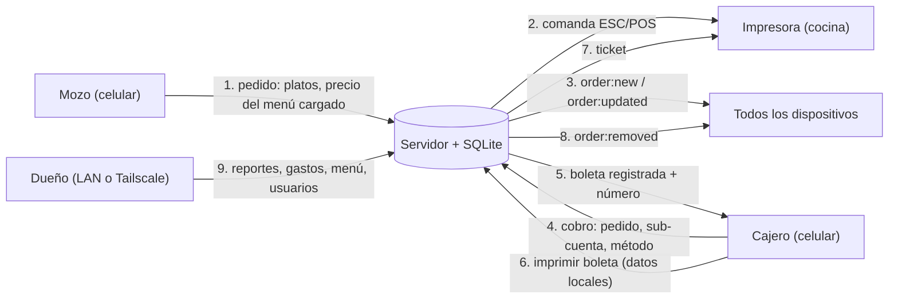

# Visión general del sistema

> Parte de la [documentación de arquitectura](README.md). Snapshot `main` @ `85664bb` (2026-09-23).

## 1. Propósito

**MauiDesk** es el sistema de punto de venta de la **Cevichería MAUI** (Tacna, Perú). Cubre la operación de salón y delivery: toma de pedidos desde el celular del mozo, comanda impresa en cocina, cobro en efectivo/Yape/Plin con cuentas divididas, boleta térmica y reportes para el dueño. Corre **completamente en la LAN del local**, sobre una Raspberry Pi 5, sin dependencia de la nube (`CLAUDE.md`, `DEPLOYMENT.md`).

No es un POS de retail: no maneja inventario, cajas con arqueo, clientes, descuentos, impuestos ni comprobantes electrónicos ([technical-debt.md](technical-debt.md#brechas-funcionales-no-son-defectos-funcionalidad-ausente)).

## 2. Usuarios y roles

| Rol (`users.role`) | Persona | Qué hace en el sistema | Pantallas visibles (`client/src/components/Layout.tsx:12-20`) |
|---|---|---|---|
| `owner` | Dueño | Todo: cobra, reportes, gastos, menú, mesas/plano, usuarios; acceso remoto por Tailscale | Mesas, Pedidos, Caja, Historial, Reportes, Menú, Usuarios |
| `cashier` | Cajero | Cobra, divide cuentas, imprime pre-cuenta y boletas, consulta el historial del día | Mesas, Pedidos, Caja, Historial |
| `waiter` | Mozo | Toma pedidos por mesa o delivery, agrega ítems, consulta el historial del día | Mesas, Pedidos, Historial |

La cocina **no es un usuario**: recibe solo la comanda impresa. La ruta `/kitchen` redirige a `/tables` (`client/src/App.tsx:42-43`). Los permisos reales difieren en algunos puntos de lo que muestra la UI ([security.md](security.md#3-autorización)).

## 3. Funcionalidades principales

| Funcionalidad | Descripción | Dónde |
|---|---|---|
| Mesas y plano | Vista de lista por zonas o plano editable (drag & drop, etiquetas, zonas coloreadas); estado libre/ocupada/por cobrar | `pages/Tables.tsx`, `routes/tables.ts` |
| Toma de pedidos | Menú por categorías, búsqueda, nivel de picante obligatorio, preferencias y notas; mesa o delivery | `pages/POS.tsx`, `routes/orders.ts` |
| Comanda automática | Al crear un pedido o agregar ítems se imprime en cocina (solo lo nuevo) | `routes/orders.ts:20-82`, `utils/printer.ts:487-541` |
| Cobro | Total, parcial por ítems o por sub-cuenta; efectivo con vuelto, Yape/Plin con confirmación manual | `pages/Cash.tsx`, `services/billing.service.ts` |
| Cuenta dividida | Hasta 6 sub-cuentas; se cobran por separado; los ítems agregados después se asignan solos | `routes/split.ts`, `Cash.tsx:190-581` |
| Boleta y pre-cuenta | Ticket térmico con logo; numeración `B001-NNNNN` generada en el servidor | `utils/printer.ts`, `routes/print.ts` |
| Historial | Boletas del día (o por rango para el dueño), detalle y reimpresión | `pages/BillsHistory.tsx`, `routes/bills.ts` |
| Reportes | Ventas por período y método, top platos, serie diaria, gastos, balance; CSV y reporte HTML | `pages/Reports.tsx`, `routes/reports.ts` |
| Administración | Platos (alta, precio, disponibilidad, baja) y usuarios | `pages/admin/*`, `routes/menu.ts`, `routes/users.ts` |
| Tiempo real | Todos los dispositivos ven los cambios de pedidos al instante; banner de reconexión | Socket.io, `store/orders.ts`, `ReconnectBanner.tsx` |
| Estado de impresora | Indicador con sondeo cada 30 s | `components/PrinterStatus.tsx`, `GET /api/print/status` |
| PWA | Instalable en la pantalla de inicio (`standalone`) | `client/public/manifest.webmanifest` |

## 4. Componentes principales

| Componente | Tecnología | Rol |
|---|---|---|
| Cliente web (PWA) | React 19 + Vite 8 + Tailwind 4 + Zustand 5 | UI para celulares; réplica local de los pedidos activos |
| Servidor | Node.js + Express 5 + TypeScript | API REST, reglas de negocio, archivos estáticos |
| Tiempo real | Socket.io 4.8 | Difusión de cambios de pedidos e impresión |
| Base de datos | SQLite (archivo) vía `@libsql/client` + Drizzle ORM | Persistencia única |
| Impresión | Generador ESC/POS propio sobre TCP (Windows solo en desarrollo) | Comandas y boletas |
| Infraestructura | Raspberry Pi 5, systemd, cron + `sqlite3 .backup`, Tailscale | Operación 24/7 local, backups y acceso remoto |

Detalle en [architecture.md](architecture.md) y [modules.md](modules.md).

## 5. Dependencias externas

| Dependencia | Tipo | Criticidad | Notas |
|---|---|---|---|
| Impresora POS-D Basic 200 (TCP 9100) | Hardware en la LAN | **Crítica**: la cocina depende de la comanda | Si no responde, se falla de inmediato sin cola (`printer.ts:299-305`); la comanda no se puede reimprimir desde la UI (TD-17) |
| Raspberry Pi 5 + microSD/SSD | Hardware | **Crítica**: punto único de falla | `DEPLOYMENT.md` documenta la microSD como trade-off y el backup diario |
| Router / WiFi del local | Red | **Crítica** | IPs reservadas por DHCP (Fase 2) |
| Tailscale | Servicio de terceros (VPN) | Baja: solo acceso remoto del dueño | Requiere internet |
| Yape / Plin | Billeteras | Sin integración | El cajero confirma la transferencia manualmente |
| rclone / Google Drive | Opcional | Baja | Copia externa de backups (Fase 11) |
| npm (librerías) | Build | — | Ver la tabla del stack en el [README](README.md#stack-tecnológico) |

No hay integraciones con SUNAT, pasarelas de pago, delivery de terceros ni servicios en la nube.

## 6. Flujo general de información

1. El mozo arma el pedido en el celular (el borrador se guarda en el navegador) y lo envía. El servidor persiste el pedido y sus ítems con el precio que envió el cliente.
2. El servidor imprime la comanda en segundo plano e informa el resultado por socket.
3. Todos los dispositivos actualizan su lista de pedidos activos.
4. El cajero selecciona el pedido (o una sub-cuenta) y cobra. El servidor calcula el total, asigna el número de boleta y cierra el pedido si ya no quedan ítems pendientes, todo en una transacción.
5–7. El cajero imprime la boleta; el contenido se arma en su dispositivo.
8. El pedido desaparece de las listas activas.
9. El dueño consulta reportes (calculados a partir de `bills`), registra gastos y administra el catálogo y los usuarios.

La información contable de una venta es la **boleta** (`bills`); el **pedido** (`orders`) es la unidad operativa. Un pedido puede tener varias boletas. Detalle de cada flujo en [business-flows.md](business-flows.md).
